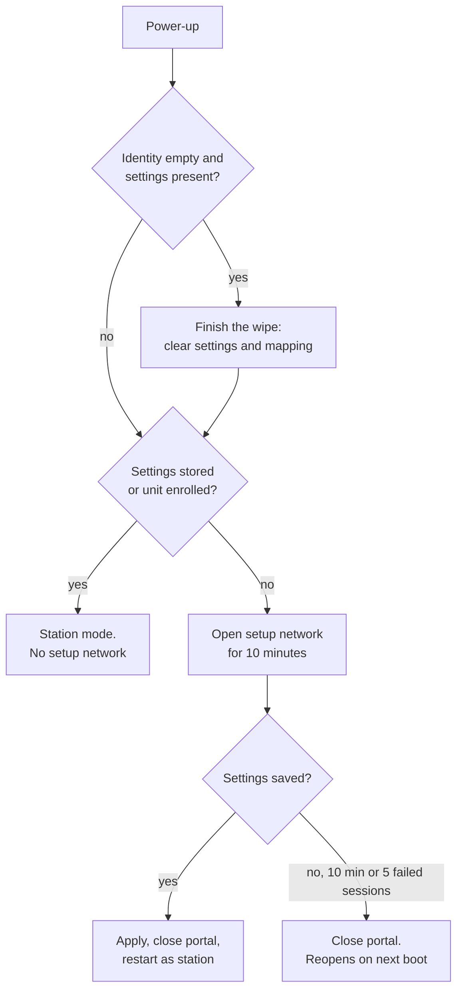
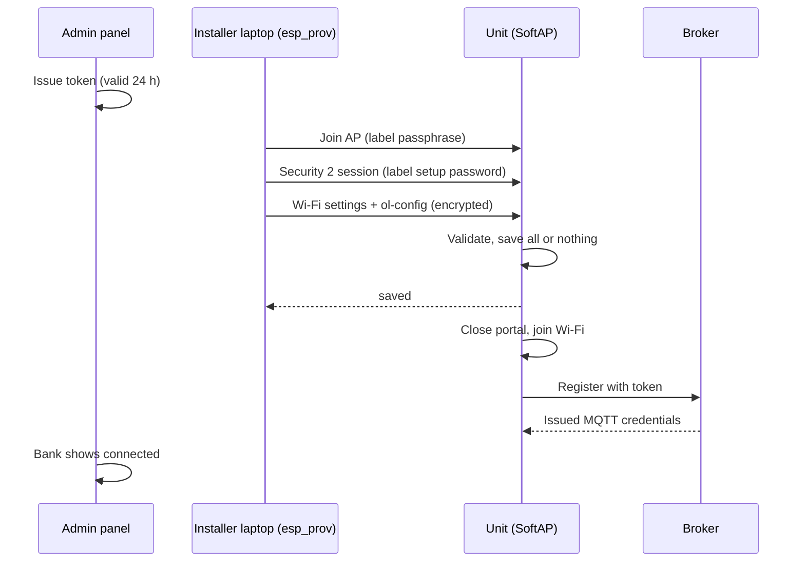
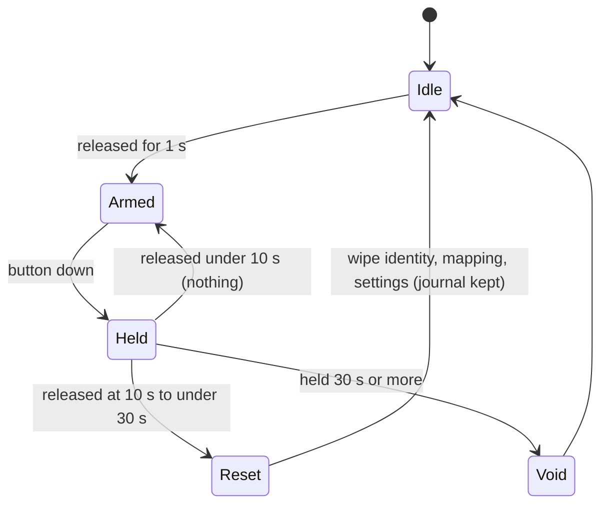

# SoftAP provisioning flows

Diagrams for [ADR-0074](adr/0074-esp32-softap-provisioning.md). The durations are
design parameters.

## Commissioning over the setup network

Who does what in `commission.py --softap`: the operator, the tool on the laptop
or phone, and the unit. The setup password is proven by both sides and never
sent; `ol-config` and the Wi-Fi settings travel inside the Security 2 session.

## Boot mode

## Commissioning from a laptop

## Reset gesture

A press at power-up, a stuck pin, a sample gap or a floating pin never arms
the gesture. Bounce under 50 ms is ignored. A rejected reset post is retried on
the next samples for about 2 s, then logged.

## Changing Wi-Fi on a deployed unit

Reset (button, 10 s), then issue a new token in the admin panel and commission
again. Production builds have no `configure`, and the portal never opens on an
enrolled unit.
