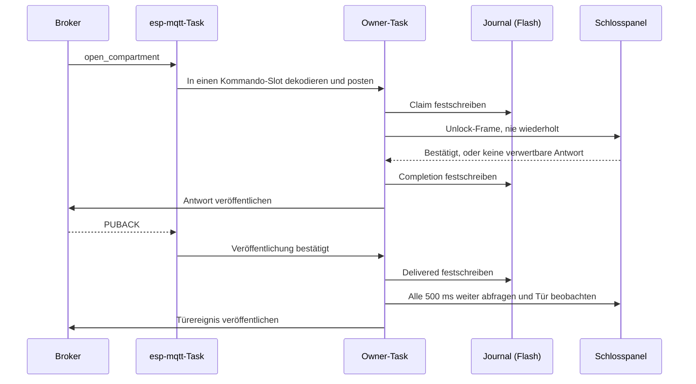
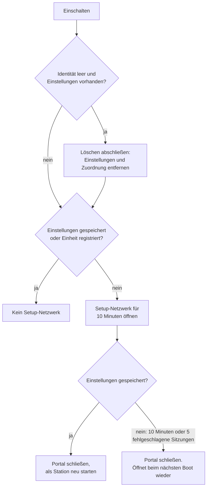

Die Firmware ist hexagonal aufgebaut, wie der Pi Client
([ADR-0024](https://github.com/Open-Locker/Open-Locker/blob/main/docs/adr/0024-locker-client-v2-hexagonal-rewrite.md)): Reine C-Use-Cases in der Mitte erreichen jede Technologie über Ports. Alle Use Cases laufen auf einem Task, ein Ereignis nach dem anderen. Die Firmware teilt die MQTT-Schemata und die Golden Frames des Panels mit dem Pi Client, aber keinen Code.

Diese Seite enthält Aufbau, Formate und Reihenfolgen hinter den Entscheidungen in den ADRs unter `docs/adr/`. Zum Bauen und Testen siehe [ESP32-Firmware entwickeln](/de/dokumentation/esp32-development/).

## Der Weg eines Öffnens



1. **Der Claim ist vor der Freigabe dauerhaft.** Ein durch einen Neustart unvollständiger Claim wird zu einer Antwort mit unbekanntem Ergebnis, nie zu einer zweiten Freigabe.
2. **Die Freigabe endet auf eine von vier Arten:** bestätigt, nicht gesendet, abgelehnt oder Ergebnis unbekannt. Auch ein unbekanntes Ergebnis schärft die Türerkennung, weil sich das Schloss bewegt haben kann.
3. **Das Ergebnis ist vor der Veröffentlichung dauerhaft.** Eine wiederholte Transaction-ID gibt die gespeicherte Antwort mit neuer Message-ID wieder und sendet nichts an das Panel.
4. **Delivered bedeutet, der Broker hat sie.** Nur der PUBACK markiert eine Antwort als zugestellt, und der Owner-Task fragt währenddessen weiter Türen ab.

Derselbe Weg gilt für jeden Client: siehe
[Locker command scenarios](https://github.com/Open-Locker/Open-Locker/blob/main/docs/locker-command-scenarios.md).

## Schichten und Komponenten

ESP-IDF-Komponenten sind die Einheit, die Abhängigkeiten durchsetzt. `verify.py` prüft die Includes und `REQUIRES` jeder einzelnen.

```text
lc_domain        <- nothing
lc_ports         <- lc_domain
lc_application   <- lc_domain, lc_ports
adapters         <- lc_domain, lc_ports, their own SDK
main             <- everything
```

Ein Adapter verlangt nie einen anderen Adapter. Müssen zwei zusammenarbeiten, übergibt der Composition Root den einen über ein kleines Struct an den anderen, wie der Bus-Adapter seinen seriellen Transport bekommt. Es gibt eine Ausnahme: `lc_softap_espidf` darf die Entscheidungen von `lc_softap_portal` ansteuern.

| Komponente | Art | Inhalt |
| --- | --- | --- |
| `lc_domain` | Rein | Fächer, Zuordnung und ihr Hash, Türerkennung, Versionen, Fehler |
| `lc_ports` | Rein, nur Header | Die Port-Structs |
| `lc_application` | Rein | Use Cases: Kommandos, `apply_config`, Zustandsveröffentlichung, Registrierung, Inbetriebnahme, Boot-Modus, Updates |
| `lc_mqtt_codec` | Rein, mit cJSON | Topics und JSON in beide Richtungen, Fragment-Zusammenbau |
| `lc_journal` | Rein | Das Kommando-Journal, über ein Flash-I/O-Struct |
| `lc_rs485_lock_board` | Rein | Frame-Codec des Panels und Bus-Adapter |
| `lc_button` | Rein | Die Zustandsmaschine der Reset-Geste |
| `lc_softap_portal` | Rein | Entscheidungen des Setup-Netzwerks: Fenster, eine Station, Endpunkte. Verlangt nur `lc_domain`, hat also keinen Weg zum Bus |
| `lc_serial_uart` | Adapter | UART-Transport für den Bus-Adapter |
| `lc_usb_console` | Adapter | Das Zeilenprotokoll der Konsole, ein treibender Adapter. Seine Zeilen-, Befehls- und Setup-Parser sind rein und werden analysiert |
| `lc_storage_nvs` | Adapter | Speicher für Einstellungen, Identität und Zuordnung; Flash-I/O der Journal-Partition |
| `lc_net_wifi` | Adapter | WLAN-Station und SNTP |
| `lc_mqtt_espidf` | Adapter | MQTT-Transport. Er bewegt nur Topics und Bytes |
| `lc_ota_espidf` | Adapter | Updates über `esp_https_ota` und `esp_ota_ops` |
| `lc_softap_espidf` | Adapter | Access Point und Protocomm für das Setup-Netzwerk |
| `main/` | Composition Root | `app_main.c` verbindet Adapter mit Ports. Außerdem Owner-Task, MQTT-Sitzung und Bench-Modus |

`main/mqtt_session.c` verbindet den Transport mit dem Codec, damit kein Adapter von einem anderen abhängt. Reine Komponenten enthalten keinen SDK- oder RTOS-Header und bauen unverändert auf einem Host.

## Ports

Ein Port ist ein Struct aus Funktionszeigern mit einem Kontextzeiger, ein Struct pro Verantwortung, in `components/lc_ports/include/lc_ports/`.

| Header | Zweck |
| --- | --- |
| `locker_bus_port.h` | Profil anwenden, freigeben, Türzustände lesen, Verbindungszustand. Protokollneutral: Leitungsprotokoll, Kanalnummerierung und Polarität bleiben im Adapter |
| `outbound_port.h` | Typisierte ausgehende Nachrichten: Antwort, Heartbeat, Snapshot, Öffnungserkennung, unbefugtes Öffnen, offline, Update-Fehler |
| `command_journal_port.h` | Finden, gesehen, Claim, Completion, Delivered und die offenen Transaktionen |
| `store_ports.h` | Speicher für Einstellungen, Identität und Zuordnung |
| `provisioning_gateway_port.h` | Antwort auf die Registrierung abonnieren, Registrierung senden |
| `firmware_update_port.h` | Laufende Version, Slot und Probezustand, Download starten und abbrechen, nächsten Slot wählen, als gültig markieren, zurückrollen |
| `clock_port.h` | Monotone Millisekunden. Die Uhrzeit bleibt im MQTT-Adapter |
| `hasher_port.h` | SHA-256 |
| `system_port.h` | Neustart |

Ausgehende Aufrufe warten nie auf den Broker. Ein Aufruf liefert eine Publish-ID, wenn der Adapter die Nachricht angenommen hat, oder `LC_PUBLISH_REFUSED`. PUBACK, Fehler oder Timeout kommen später als Control-Ereignisse mit dieser ID.

## Task-Modell

Andere Tasks rufen nie einen Use Case auf. Sie posten an die begrenzten Eingänge des Owner-Tasks und warten nie
([ADR-0080](https://github.com/Open-Locker/Open-Locker/blob/main/docs/adr/0080-esp32-owner-task.md)).

| Task | Aufgabe |
| --- | --- |
| `owner` | Jeder Use Case, im 100-ms-Takt |
| `lc_console` | Die USB-Konsole. Bench-`unlock` und `query` erreichen den Bus direkt |
| MQTT-Client | esp-mqtt. Dekodiert ein Kommando direkt in einen Pool-Slot und postet ihn |
| Download | `lc_ota_espidf`, nur während eines Downloads. Postet, wie der Download endete |
| `button` | Fragt den Reset-Pin alle 20 ms ab |

`main/bus_guard.c` legt einen Mutex um den Bus-Port, sodass sich eine Konsolenanfrage und der Owner-Task am Panel nie überschneiden. Der Owner-Task wartet nur auf eine Antwort des Panels, begrenzt durch die Bus-Frist. In untätigen Takten erledigt er die Hintergrundarbeit des Journals, eine Sektorlöschung oder Kompaktierung nach der anderen.

### Die Eingänge des Owner-Tasks

| Eingang | Größe | Bei Überlauf |
| --- | --- | --- |
| Control-Queue | 12-Byte-Ereignisse, 32 tief | Das Ereignis geht verloren und wird protokolliert. Ein verlorener PUBACK lässt die Antwort unzugestellt, sie wird nach 60 s erneut veröffentlicht |
| Kommando-Pool | 32 Slots, an Ort und Stelle dekodiert | Das Kommando wird verworfen und protokolliert, bevor etwas beansprucht wird, gibt also nie frei. Das Backend läuft in den Timeout |
| Setup-Mailbox | Ein Slot | Der Sender wird abgelehnt und informiert |
| Mailbox für Provisionierungsantworten | Ein Slot | Der Sender wird abgelehnt und informiert |

Jeder Schritt behandelt höchstens 32 Control-Ereignisse, dann die Mailboxen, dann ein Kommando, dann seinen Takt. Ein Schub Bestätigungen kann kein Kommando verdrängen, und ein voller Pool kann keine Bestätigung verlieren. Ein `_Static_assert` in `main/owner_queue.h` lässt den Build fehlschlagen, wenn die Eingänge ihr Budget von 24 KiB überschreiten.

Ein hängender Chip startet neu: Der Task-Watchdog ist in `sdkconfig.defaults` auf Panic gesetzt.

## Sicherheitsregeln und ihre Tests

Jede Regel wird von den Host-Tests mit dem genannten Präfix gehalten, im Katalog `locker-firmware/docs/testing.md`.

| Regel | Tests |
| --- | --- |
| Eine Freigabe wird nie wiederholt. Beim Start oder Neuverbinden wird kein Unlock-Frame gesendet, und Leitungskanal null (alle öffnen) wird nie erzeugt | S1 |
| Nach einem Timeout bleibt der Bus für eine Settle-Zeit still, damit eine späte Antwort nicht der nächsten Anfrage zugeschrieben wird | S1 |
| Der Claim ist vor der Freigabe dauerhaft, das Ergebnis vor der Antwort, und Delivered erst nach dem PUBACK | S2 |
| Ein beschädigter Journal-Eintrag stoppt jede Betätigung. Ein abgerissener letzter Eintrag zählt als nie geschrieben, außer einem Claim mit intaktem Inhalt, der offen bleibt | S2 |
| `apply_config` kann nicht während einer Freigabe laufen | S2 |
| Das Token wird erst veröffentlicht, wenn das Antwort-Abonnement bestätigt und das Pending-Flag gespeichert ist. Eine verlorene Antwort führt nie zu einer zweiten Registrierung | S3 |
| Fehlende Statusbits und wiederholt fehlgeschlagene Abfragen melden `unknown`, ohne falsche Türereignisse nach einem Neuverbinden | S4 |
| Fehlerhafte Eingaben bei der Inbetriebnahme speichern nie Teileinstellungen | S5 |
| Kein Weg führt vom Setup-Netzwerk zum Bus-Port | S6 |
| Kein Schritt eines Updates ruft die Bus-Freigabe auf. Der nächste Slot wird erst nach der Prüfung gewählt | S7 |

## Bekannte Risiken

- **Späte Antworten.** Das Panel-Protokoll hat keine Anfrage-ID. Die Settle-Zeit deckt nur Antworten innerhalb der schlechtesten Antwortzeit des Panels ab, die HW-A9 messen soll. Der Prüfaufbau maß etwa 265 ms; der Lauf mit 200 Freigaben ist zurückgestellt.
- **Flash bei Stromausfall.** Host-Tests schneiden Journal-Schreib- und Löschvorgänge an jedem Byte ab. Echter Flash kann trotzdem anders ausfallen.
- **RAM.** Journal-Index, MQTT-Puffer und TLS teilen sich einige hundert Kilobyte. Siehe [Flash & RAM](/de/dokumentation/esp32/memory/).
- **Abweichung vom Pi Client.** Es gibt zwei Implementierungen eines Vertrags. Die gemeinsamen Schemata und Golden Frames sind die Kontrolle.
- **Adapter ohne Host-Tests.** `lc_serial_uart`, `lc_net_wifi`, `lc_storage_nvs` und der größte Teil von `main/` werden nur am Prüfaufbau geprüft.

## Entsprechungen im Pi Client

| Pi Client (`locker-client/src/`) | ESP32-Firmware (`locker-firmware/`) |
| --- | --- |
| `domain/compartment.ts`, `config.ts` | `lc_domain/compartment.h`, `config.c` |
| `domain/door-detection.ts` | `lc_domain/door_detection.c` |
| `domain/errors.ts` | `lc_domain/errors.h` (die Texte liegen im Codec) |
| `ports/locker-bus.port.ts` | `lc_ports/locker_bus_port.h` |
| `ports/mqtt.port.ts`, `DedupStorePort` | `lc_ports/command_journal_port.h` |
| `ports/mqtt.port.ts`, `OutboundMqttPort`, `door-events.port.ts` | `lc_ports/outbound_port.h` |
| `ports/config.port.ts` | `lc_ports/store_ports.h`, `clock_port.h` |
| `application/open-compartment.ts` | `lc_application/open_compartment.c` |
| `application/apply-config.ts` | `lc_application/apply_config.c` |
| `application/state-publishing.ts` | `lc_application/publish_state.c` |
| `application/provision-device.ts` | `lc_application/provision_device.c` |
| `adapters/mqtt/command-dispatcher.ts`, `inbound-protocol-guard.ts` | `lc_application/handle_command.c` |
| `adapters/mqtt/outbound-envelope.ts`, `domain/mqtt-parsing.ts` | `lc_mqtt_codec/` |
| `adapters/rs485/rs485-lock-board-codec.ts` | `lc_rs485_lock_board/codec.c` |
| `adapters/rs485/rs485-lock-board-bus-actor.ts` | `lc_rs485_lock_board/bus.c` |
| `adapters/rs485/serialport-transaction.transport.ts` | `lc_serial_uart/` |
| `adapters/mqtt/dedup-store.ts` | `lc_journal/` |
| `bootstrap/createApp.ts` | `main/app_main.c` |

Der Command-Guard liegt hier in der Anwendungsschicht, weil der Claim vor jedem Seiteneffekt dauerhaft sein muss und das Journal der Dedup-Speicher ist. `commission_device.c` hat kein Gegenstück im Pi Client.

## Kommando-Journal

Entschieden in ADR-0070 und ADR-0081.

### Regions-Header

Die Partition `journal` ist in zwei Regionen von 128 KiB geteilt. Eine Region beginnt mit 16 Bytes, die nach all ihren Einträgen geschrieben werden:

| Offset | Größe | Inhalt |
| --- | --- | --- |
| 0 | 4 | Magic `OLJR` |
| 4 | 1 | Formatversion `0x01` |
| 5 | 3 | `0xFF` |
| 8 | 4 | Generation, Little Endian, 1 bis `0xFFFFFFFE` |
| 12 | 4 | CRC-32 (IEEE) der Bytes 0 bis 11, Little Endian |

Beim Start:

- Ein gültiger Header: Diese Region ist aktiv.
- Zwei gültige Header: Die höhere Generation ist aktiv. Gleiche Generationen markieren das Journal als unhealthy.
- Kein gültiger Header und nichts außerhalb der ersten 16 Bytes von Region A programmiert: ein leeres Journal. Der erste Eintrag schreibt Generation 1 in Region A.
- Kein gültiger Header und irgendein Eintragsbyte programmiert: Das Journal ist unhealthy.

Jede Kompaktierung löscht eine Region, der Flash verschleißt also nach etwa 200.000 Kompaktierungen
([ADR-0081](https://github.com/Open-Locker/Open-Locker/blob/main/docs/adr/0081-esp32-command-journal-retention.md)), weit vor einem Überlauf der Generation.

### Eintrag, Version 1

Einträge folgen ab Offset 16:

| Offset | Größe | Inhalt |
| --- | --- | --- |
| 0 | 1 | Magic `0xA7` |
| 1 | 1 | Formatversion `0x01` |
| 2 | 1 | Typ: 1 Claim, 2 Completion, 3 Delivered, 4 Message |
| 3 | 2 | Nutzlastlänge, Little Endian, höchstens 320 |
| 5 | 1 | Header-Prüfung: CRC-8 (Polynom 0x07) der Bytes 1 bis 4 |
| 6 | n | Nutzlast |
| 6 + n | 4 | Eintragsprüfung: CRC-32 (IEEE) von Byte 1 bis zum Ende der Nutzlast, Little Endian |
| 10 + n | 1 | Commit-Marker `0xC3` |

Die Nutzlast ist eine Folge von Texten mit Längenpräfix (ein Längenbyte, dann die Bytes, höchstens 128 und kein NUL) und einzelnen Bytes:

- Claim: Transaction-ID, Message-ID, Aktionsname;
- Completion: Transaction-ID, Aktionsname, Fehlercode (ein Byte), Hash der angewendeten Konfiguration (leer, außer ein `apply_config` war erfolgreich);
- Delivered: Transaction-ID;
- Message: Transaction-ID, eine weitere Message-ID dazu.

Der größte Eintrag hat 331 Bytes. Die Prüfungen decken die Position des Eintrags nicht ab, ein Eintrag lässt sich also unverändert in eine andere Region kopieren. Ein fehlgeschlagener Schreib- oder Löschvorgang markiert das Journal bis zum nächsten Start im Speicher als unhealthy.

### Lesen

Beim Start wird die aktive Region ab Offset 16 gelesen:

1. `0xFF` am Beginn eines Eintrags beendet das Log, wenn jedes Byte danach `0xFF` ist. Mit programmierten Bytes danach ist es ein beschädigter Header (Regel 3 oder 4).
2. Ein Eintrag, der jede Prüfung besteht und auf `0xC3` endet, ist festgeschrieben.
3. Das Ende ist abgerissen, nicht beschädigt, wenn es nicht auf einen gültigen `0xC3`-Marker endet: Sein Marker ist gelöscht oder teilweise programmiert, oder sein Header ist beschädigt und das letzte programmierte Byte liegt innerhalb von 331 Bytes ab seinem Beginn. Ein abgerissener Claim, dessen Inhalt seine CRC-32 besteht, bleibt als offener Claim erhalten, weil ein Bitfehler in seinem Marker genauso aussieht wie ein abgebrochener Schreibvorgang. Die nächste Kompaktierung kopiert ihn mit Marker.
4. Alles andere markiert das Journal als unhealthy: ein beschädigter Eintrag, dem irgendein programmiertes Byte folgt, ein Eintrag, der auf `0xC3` endet, aber eine Prüfung nicht besteht, eine unbekannte Version oder ein unbekannter Typ und ein intakter Eintrag ohne Sinn (ein Claim für eine bekannte ID, eine Completion oder Delivery für eine Transaktion nicht in diesem Zustand, ein unbekannter Fehlercode).

Abgerissene Reste werden nie überschrieben: Der nächste Eintrag kompaktiert zuerst und lässt sie in der alten Region zurück.

### Wechsel in die andere Region

1. Die zu behaltenden Einträge werden Byte für Byte in die freie Region kopiert, hinter deren Header-Platz, in Log-Reihenfolge.
2. Der Header der freien Region wird mit Generation + 1 geschrieben. Ab diesem Schreibvorgang ist die neue Region aktiv.
3. Der Header-Sektor der alten Region wird sofort gelöscht. Der Rest wird vorab als nächste freie Region gelöscht, ein Sektor pro untätigem Takt, und zurückgelesen: Bereit ist sie nur, wenn jedes Byte `0xFF` liest. Eine zweimal fehlgeschlagene Leerprüfung markiert das Journal als unhealthy. Nach einem Neustart wird die freie Region einmal gelesen, und eine leere wird nicht erneut gelöscht, damit eine Boot-Schleife den Flash nicht verschleißt.

Ein Stromausfall vor Schritt 2 lässt die alte Region aktiv und die halb beschriebene freie Region ohne Header; sie wird erneut gelöscht. Ein Stromausfall zwischen den Schritten 2 und 3 hinterlässt zwei gültige Header, und die höhere Generation gewinnt.

### Index im RAM

Ein Scan baut einen statisch angelegten Index von etwa 15 KiB, der keine ID-Texte und keine Antworten enthält: pro Transaktion einen 8-Byte-FNV-1a-Hash ihrer ID, ihren Zustand, die Flash-Offsets von Claim und Completion sowie Eintragsgrößen; pro Message-ID einen Hash, ihre Transaktion und einen Offset. Ein Hash-Treffer wird durch Lesen des Eintrags aus dem Flash bestätigt, eine Kollision ist also nur eine Abweichung. Ein fehlgeschlagener Lesevorgang markiert das Journal als unhealthy.

### Ein unhealthy Journal wiederherstellen

```bash
parttool.py --port <port> --partition-table-offset 0xC000 erase_partition --partition-name journal
```

Danach die Einheit erneut in Betrieb nehmen.

## Setup-Netzwerk und Reset

Entschieden in ADR-0074 und ADR-0083.

### Boot-Modus

`lc_boot_decide()` läuft bei jedem Start zuerst:



Eine Einheit ohne Einstellungen ist im Bench-Modus, unabhängig davon, ob ihr Setup-Netzwerk offen ist, und das Setup-Netzwerk bleibt geschlossen, wenn der Namespace `lc_setup` keine Secrets enthält. Kein Standardpasswort springt ein.

### `ol-config`-Nutzlast

Der eigene Endpunkt trägt, was der WLAN-Endpunkt nicht kann: ein Versionsbyte (`1`), dann Tag-Length-Value-Einträge mit einem Byte Tag und einem Byte Länge. Die Tags sind `1` Broker-URL (bis 192 Bytes), `2` Bootstrap-Benutzer, `3` Bootstrap-Passwort und `4` Token (je bis 128 Bytes). Kein Feld darf leer sein oder ein NUL enthalten. Die Antwort ist ein Statusbyte, gleich für jede Ablehnung und verschlüsselt wie die Anfrage. Das Werkzeug sendet `ol-config` zuerst, weil der WLAN-Teil die Einheit dazu bringt, sich selbst in Betrieb zu nehmen.

### Löschreihenfolge und Boot-Reparatur

- Ein Reset schreibt zuerst die leere Identität und löscht nichts, wenn das fehlschlägt. Dann versucht er, Zuordnung und Einstellungen zu entfernen, und liefert ein eigenes Ergebnis „partial“, wenn eines davon fehlschlägt.
- Beim Boot ist eine leere Identität mit vorhandenen Einstellungen kein Zustand, den ein normaler Weg erzeugt. Die Boot-Logik schließt das Löschen ab und entscheidet dann den Modus. Dieselbe Regel repariert ein fehlgeschlagenes Rollback in `commission_apply`.
- Eine leere Identität mit Zuordnung und ohne Einstellungen ist ein gültiger Bench-Zustand und bleibt unangetastet.
- Klappt das Entfernen der Einstellungen, aber nicht das der Zuordnung, behält die Einheit eine veraltete Zuordnung, die sich nicht von einer Bench-Zuordnung unterscheiden lässt. Das Backend markiert die Konfiguration eines zurückgesetzten Schranks als geändert und sendet nach der Registrierung ein frisches `apply_config`, und das Ergebnis „partial“ wird protokolliert.

### Installationswerkzeug

Für den Pilotbetrieb nutzen Installateur:innen `scripts/commission.py --softap`. Es verwendet das `esp_prov` der `network_provisioning`-Kopie in `managed_components/` der Firmware, Werkzeug und Firmware stammen also immer aus demselben Build, und liest die Security-2-Patch-Stufe aus der `proto-ver`-Antwort der Einheit. Es liest Secrets ohne Anzeige, schreibt sie nie auf die Festplatte und sendet nach einer verlorenen Verbindung nie erneut.

### Bench-Spike vom 21.10.2026

Einmal ausgeführt mit ESP-IDF 6.1, network_provisioning 3.0.0 und einem ESP32 rev 3.1 mit 4 MB Flash, auf einem Development-Build. Das ist ein Spike, nicht der Abnahmelauf der Gruppe F.

| Frage | Ergebnis |
| --- | --- |
| Spricht `esp_prov` mit unseren Protocomm-Endpunkten und trägt `ol-config`? | Ja. `commission.py --softap` führte `proto-ver`, die Security-2-Sitzung (Patch-Stufe 1), `ol-config` und `prov-config` gegen eine gelöschte Einheit aus, die speicherte, dem WLAN beitrat, sich registrierte, ihre Konfiguration anwendete und ein Fach aus dem Admin-Panel öffnete |
| Ist `ol-config` durch die Sitzung verschlüsselt? | Ja. Jedes TCP-Byte, das das Werkzeug sendete und empfing, wurde auf dem Client aufgezeichnet, mit erfundenen Werten. Keiner der sieben Werte erscheint, weder als UTF-8 noch als UTF-16. `ol-config` hat 90 Bytes bei 74 Bytes Nutzlast (ein 16-Byte-Tag). Nur `proto-ver` ist im Klartext. Der Mitschnitt entstand oberhalb von WPA2 |
| Freier Heap bei laufendem Portal? | Genug; AP-only bleibt. Tiefstwert über eine ganze Sitzung: 99.268 Bytes bei AP-only, 97.600 bei AP+STA. Größter freier Block 98.304. Abgetastet alle 2 s, die letzten Sekunden vor dem Neustart sind also nicht abgedeckt |
| ESP-IDF 6.1 und der lwIP-DHCP-Server-Hinweis (GHSA-g764-gwc3-75m5, CVE-2026-45160)? | In 6.1 behoben. Keine weitere Festlegung |
| Zählt ein 10 s gehaltener Jumper von GPIO 4 nach GND als Druck? | Noch nicht ausgeführt |

## OTA-Update auf dem Gerät

:::note[Geplant]
Over-the-Air-Updates sind noch nicht umgesetzt. Sie kommen mit [#336](https://github.com/Open-Locker/Open-Locker/pull/336), sobald das
Konzept für die Image-Signierung steht. Dieser Abschnitt beschreibt den Plan.
:::

Entschieden in ADR-0075.

### Reihenfolge eines Updates

1. **Leerlaufprüfung.** Das Kommando wird wie jedes andere ins Journal geschrieben, eine Wiederholung mit derselben Transaction-ID lädt also nicht zweimal.
2. **Versionsregel.** Vor dem Start eines Downloads lehnt die Anwendung ab: eine Version gleich der laufenden, eine niedrigere ohne `allow_downgrade` und eine, von der diese Einheit schon zurückgekehrt ist; außerdem, wenn sie die laufende Version nicht vergleichen kann. Verglichen wird nach semantischer Versionierung, und `PROJECT_VER` stammt aus dem Release-Tag.
3. **Download.** Der Image-Header wird über `esp_https_ota_get_img_desc()` nach `begin` und vor dem Schreiben jedes Bytes gelesen. Ein nicht lesbarer Header ist ein fehlgeschlagener Transfer, eine andere Version als im Kommando eine fehlgeschlagene Verifikation.
4. **Slot-Auswahl.** `esp_https_ota_finish` prüft das Image und ruft selbst `esp_ota_set_boot_partition` auf, der Adapter also nie. Kann das Journal die Antwort nach dem Download-Start nicht speichern, bricht die Anwendung den Download ab: Nichts wird veröffentlicht, was das Journal nicht hält.
5. **Neustart.** Sobald keine Tür mehr beobachtet wird. Noch nicht bestätigte Antworten halten ihn nicht auf; das Journal sendet sie nach dem Neustart erneut. Während des Downloads eintreffende Öffnungen bedient der Owner-Task wie gewohnt.
6. **Probe.** Das neue Image bootet zur Probe und markiert sich als gültig oder kehrt zurück
   ([ADR-0085](https://github.com/Open-Locker/Open-Locker/blob/main/docs/adr/0085-esp32-trial-boot-and-rollback.md)).

### Die Version „schon zurückgekehrt“

Die Firmware speichert sie nicht. Es ist die Version des Slots, den der Bootloader zuletzt als ungültig oder abgebrochen markiert hat (`esp_ota_get_last_invalid_partition()`), was auch einen Absturz, einen Watchdog-Reset oder einen Stromausfall während einer Probe abdeckt. Die Angabe verschwindet, sobald der nächste Download diesen Slot löscht, und dann darf dieselbe Version erneut versucht werden.

### Logging

Der Adapter protokolliert nur die Version, schaltet während eines Downloads das Log-Tag `HTTP_CLIENT` stumm, weil der HTTP-Client die ganze URL ausgibt, wenn er sie nicht parsen kann, und löscht seine Kopie der URL am Ende des Downloads.

## Firmware-Rollout im Backend

:::note[Geplant]
Der Rollout im Backend ist noch nicht umgesetzt. Er kommt mit den Over-the-Air-Updates
in [#336](https://github.com/Open-Locker/Open-Locker/pull/336). Dieser Abschnitt beschreibt den Plan.
:::

Entschieden in ADR-0077.

### Anforderungen und Ablehnungen

Die Admin-Aktion „Firmware aktualisieren“ (`lockerbank.configure`) ruft `LockerService::requestFirmwareUpdate()` auf, das `FirmwareUpdateRequested` aufzeichnet (Schrank, Release-ID, Version, Transaction-ID, `allow_downgrade`, Akteur). Ein Reactor veröffentlicht `update_firmware` über einen typisierten Publisher. Abgelehnt wird eine Anforderung für:

- einen Schrank, der nicht provisioniert ist;
- einen Schrank, dessen Heartbeat `firmware_update` nicht angekündigt hat;
- ein bereits laufendes Update;
- ein als ungültig markiertes Release;
- eine Version, die der Schrank bereits meldet (`already_running`), weil ein Heartbeat ein Update auf die laufende Version nicht von gar keinem Update unterscheiden könnte;
- einen Download-Link, den die Firmware ablehnen würde: nicht `https://` oder über 256 Zeichen.

### Status

Der Status ist *requested*, *downloading*, *completed* oder *failed*, von einem Projector in Firmware-Spalten von `locker_banks` geschrieben. Er wirkt nur für die Transaktion, die der Schrank verfolgt, ein spätes oder altes Ereignis einer anderen Transaktion ist also nur Historie.

| Von | Auslöser | Nach |
| --- | --- | --- |
| *requested* | Erfolgsantwort, abgeleitet in `CommandResponseReactor` | *downloading* |
| Laufend | Fehlerantwort oder `firmware_update_failed`, abgeleitet in `FirmwareUpdateReactor` | *failed*, mit dem Code |
| Laufend | Heartbeat mit der Zielversion und `trial: false` (`FirmwareUpdateCompleted`) | *completed* |
| *downloading* | Heartbeat mit `last_rollback_version` gleich dem Ziel (`FirmwareUpdateFailed`, Grund `rollback`) | *failed* |
| Laufend | Kein Ergebnis 30 Minuten nach der Anforderung (`FirmwareUpdateFailed`, Grund `timeout`) | *failed* |

- Completion gilt auch ab *requested*, wenn das Gerät fertig war, bevor die Annahmenachricht eintraf.
- Ein Rollback zählt nur während *downloading*. Vor der Annahme meldet eine Einheit, die von dieser Version früher zurückgekehrt ist, sie weiterhin, und das Gerät lehnt die Version selbst ab.
- Eine Antwort zählt nur für ein Update, das dieses Backend von diesem Schrank angefordert hat.
- Ein bereits abgelaufenes Update bleibt fehlgeschlagen, auch wenn sein Heartbeat später eintrifft.
- Der Fehlergrund ist ein eigenes Feld `reason` neben `errorCode`, das die `UPDATE_*`-Codes des Geräts behält.
- `FirmwareUpdateOutcomeService` leitet Completion und Rollback ab.

### Heartbeat-Felder

`LockerHeartbeatHandler` schreibt `firmware_version`, `firmware_trial`, `firmware_running_slot`, `firmware_last_rollback_version`, `firmware_reported_at` und `firmware_update_capable` (aus `capabilities`) nach `locker_banks`, wie auch `modbus_connected`. Ein Heartbeat ohne sie lässt die gespeicherten Werte unberührt, und `capabilities` ohne `firmware_update` entfernt die Fähigkeit.

Ist ein Feld fehlerhaft, einschließlich fehlendem `trial` bei `firmware_version`, werden letzter Heartbeat, Verbindungszustand und Modbus-Felder trotzdem aktualisiert. Eine Warnung nennt die Felder, aber nicht die Nutzlast.

### Admin-Oberfläche

Die Schrankliste zeigt die gemeldete Version und den Update-Status. Die Bearbeitungsansicht zeigt Slot, Probezustand, letzte Rollback-Version, Ziel, Fehlercode und Fehlergrund. „Firmware aktualisieren“ hat eine Release-Auswahl und einen Schalter „Downgrade erlauben“, erscheint nur bei Schränken, die die Fähigkeit gemeldet haben, und zeigt eine Ablehnung als übersetzte Benachrichtigung. Manager:innen sehen sie nicht.
