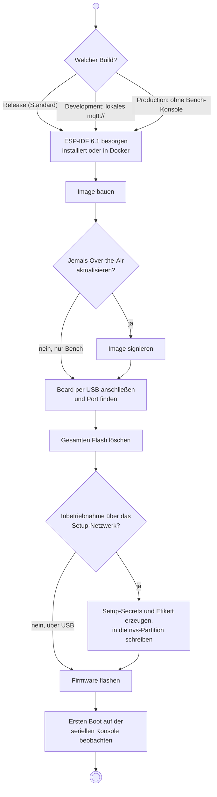
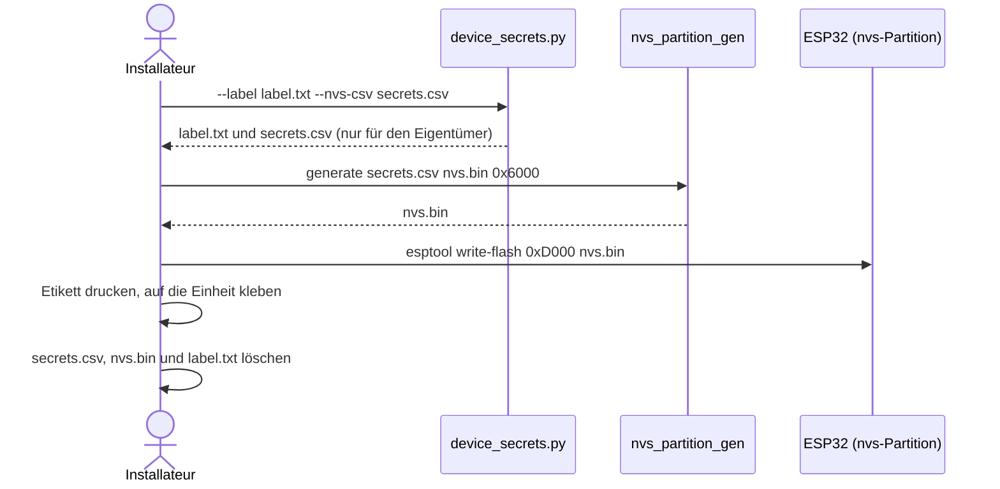
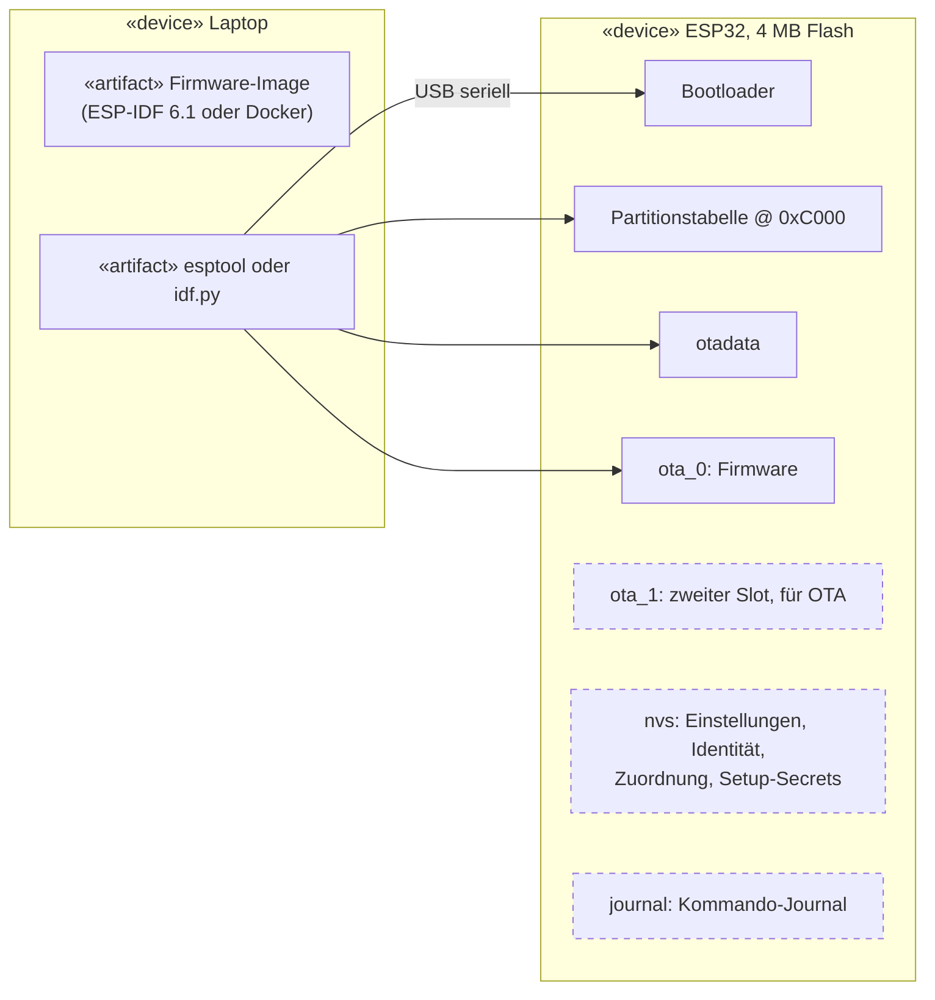

Diese Seite führt einen neuen ESP32 von leer bis zur gebooteten Open-Locker-Firmware. Eine Einheit, die
über das Setup-Netzwerk in Betrieb genommen wird, bekommt zusätzlich eigene Setup-Secrets und ein Etikett.
Die [Inbetriebnahme](/de/dokumentation/esp32/commissioning/) selbst folgt nach dem
[Bench-Test](/de/dokumentation/esp32/bench-test/).

:::caution[Bench-Firmware]
Kein Build hat bisher Flash- oder NVS-Verschlüsselung. WLAN-Passwort, Broker-Zugangsdaten und
Setup-Secrets liegen im Klartext auf dem Chip. Eine geflashte Einheit nicht dort lassen, wo jeder sie
erreichen kann.
:::

## Der gesamte Ablauf



*UML-Aktivitätsdiagramm. Jeder Schritt ist ein Abschnitt weiter unten.*

## Vorbereitung

- **Das Board:** ein ESP32 D1 mini oder ein anderer ESP32 (Target `esp32`) mit **4 MB Flash** und Chip
  **Revision 3.0 oder neuer**. Das Flash-Layout setzt genau 4 MB voraus, die Image-Signierung der Firmware
  braucht diese Revision.
- **Ein USB-Datenkabel.** Viele günstige Kabel laden nur. Erscheint beim Einstecken kein neuer serieller
  Port, zuerst ein anderes Kabel versuchen.
- **Ein USB-Seriell-Treiber**, falls das System einen braucht. Das Bench-Board nutzt einen CH9102-Chip.
  Linux bringt den Treiber mit, Windows und macOS brauchen eventuell den Treiber des Herstellers.
- **Python 3** und die Werkzeuge der Firmware, einmal pro Laptop:

  ```bash
  git clone https://github.com/Open-Locker/Open-Locker.git
  cd Open-Locker/locker-firmware
  pip install -r requirements.txt
  ```

Alle Befehle auf dieser Seite laufen in `locker-firmware/`.

:::tip[Schloss stromlos lassen]
Die Firmware soll beim Booten nichts an das Schlosspanel senden, die zugehörige Hardwareprüfung hat aber
kein abgezeichnetes Ergebnis. Die Panelversorgung beim Flashen ausgeschaltet lassen.
:::

## Fertige Firmware

:::note[Noch nicht verfügbar]
Es gibt keine veröffentlichten Firmware-Images. CI baut das Image, veröffentlicht es aber nicht, es muss
also wie unten beschrieben selbst gebaut werden.
:::

## Build wählen

Es gibt einen Quellbaum und drei Konfigurationen. Sie unterscheiden sich darin, was die Einheit akzeptiert,
nicht darin, wie geflasht wird.

| Build | Verwendung | Unverschlüsselter `mqtt://`-Broker | Bench-Konsolenbefehle |
| --- | --- | --- | --- |
| **Release** (Standard) | Jede Einheit, die mit einem echten Backend spricht | Abgelehnt, nur `mqtts://` | Ja |
| **Development** | Ein lokales Backend mit unverschlüsseltem MQTT-Broker | Erlaubt | Ja |
| **Production** | Einheiten, die nur über das Setup-Netzwerk in Betrieb gehen | Abgelehnt | Nein: `configure`, `unlock`, `command` und `reset-network` fehlen |

Die Bench-Konsolenbefehle nutzen der [Bench-Test](/de/dokumentation/esp32/bench-test/) und die
USB-Inbetriebnahme. Ein Production-Build lässt sich nur über das Setup-Netzwerk in Betrieb nehmen.

:::caution
Ein Production-Build ist noch **nicht** freigabefähig: Ihm fehlt die Flash- und NVS-Verschlüsselung.
:::

## Toolchain einrichten

Eine Variante wählen.

**ESP-IDF installiert.** Dem
[Einstiegsleitfaden von Espressif für ESP-IDF 6.1](https://docs.espressif.com/projects/esp-idf/en/v6.1/esp32/get-started/)
folgen und eine ESP-IDF-Shell öffnen (unter Windows die Verknüpfung „ESP-IDF 6.1 PowerShell“). Alle
folgenden `idf.py`- und `python -m esptool`-Befehle laufen darin.

**Docker, nichts installiert.** Das Image `espressif/idf:v6.1` baut die Firmware. Docker unter Windows und
macOS erreicht den USB-Port nicht, geflasht wird dort mit `esptool`, einmalig zu installieren mit
`pip install esptool`. Das installiert auch `espsecure`, das Images signiert.

## Image bauen

Der erste Build lädt die Abhängigkeiten der Firmware und dauert einige Minuten.

| Build | ESP-IDF-Shell |
| --- | --- |
| Release | `idf.py build` |
| Development | `idf.py -D SDKCONFIG_DEFAULTS="sdkconfig.defaults;sdkconfig.dev" build` |
| Production | `idf.py -D SDKCONFIG_DEFAULTS="sdkconfig.defaults;sdkconfig.production" build` |

Mit Docker denselben `idf.py`-Befehl hinter
`docker run --rm -v "$PWD:/project" -w /project espressif/idf:v6.1` setzen, zum Beispiel:

```bash
docker run --rm -v "$PWD:/project" -w /project espressif/idf:v6.1 idf.py build
```

In PowerShell `${PWD}` statt `$PWD` schreiben. Unter Linux gehören `build/` und `managed_components/` danach
root, also vor der Nutzung außerhalb des Containers `sudo chown -R "$USER": .` ausführen.

Ein Build ohne Version meldet `0.0.0-dev`. Eine Version wird über die Umgebung gesetzt. Sie muss
semantischer Versionierung folgen, ohne führendes `v` oder Build-Metadaten, höchstens 31 Zeichen, sonst
bricht der Build ab:

```bash
LC_FIRMWARE_VERSION=0.2.0 idf.py build
```

Mit Docker `-e LC_FIRMWARE_VERSION=0.2.0` hinter `docker run --rm` ergänzen. CMake beobachtet die Umgebung
nicht, nach einer Änderung also `idf.py reconfigure` ausführen.

:::caution[Build wechseln]
Vor dem Bauen einer anderen Konfiguration die Datei `sdkconfig` (und den Ordner `build/`) löschen. Sonst
bleiben die Werte des vorherigen Builds erhalten: Ein Release-Build akzeptiert dann zum Beispiel weiter
`mqtt://`, oder ein Development-Build lehnt es weiter ab.
:::

## Image signieren

Für eine Bench-Einheit, die nie Over-the-Air aktualisiert wird, entfällt das. Eine Einheit prüft ein Update
gegen den öffentlichen Schlüssel im Image, das sie gerade **ausführt**. Eine Einheit mit unsigniertem Image
kann also nie ein Update verifizieren. Der Build schreibt ein unsigniertes Image, signiert wird danach.

1. Einen Schlüssel erzeugen, einmal pro Prüfaufbau. Er bleibt außerhalb des Repositorys: Das Werkzeug lehnt
   einen Schlüsselpfad darin ab und überschreibt nie einen Schlüssel.

   ```bash
   python scripts/sign_firmware.py --generate-key ~/keys/bench.pem
   ```

2. Das Image signieren:

   ```bash
   python scripts/sign_firmware.py ~/keys/bench.pem build/locker-firmware.bin
   ```

   Es erscheint `signed image: build/locker-firmware-signed.bin`.

Beides läuft in einer ESP-IDF-Shell oder mit installiertem `esptool`. Mit Docker zusätzlich den
Schlüsselordner einbinden: `-v "$HOME/keys:/keys"` ergänzen und den Pfad `/keys/bench.pem` verwenden.

:::caution[Ein Schlüssel lässt sich nicht Over-the-Air ersetzen]
Ein Image trägt eine Signatur, und eine Einheit akzeptiert nur Images, die mit dem Schlüssel des laufenden
Images signiert sind. Ein verlorener oder kompromittierter Schlüssel bedeutet, jede Einheit per USB zu
flashen. Ein Bench-Schlüssel signiert nie ein Release-Image, Bench-Einheiten akzeptieren also nie ein
Release-Image und umgekehrt.
([ADR-0084](https://github.com/Open-Locker/Open-Locker/blob/main/docs/adr/0084-esp32-firmware-image-signing.md))
:::

## Board anschließen

Das Board einstecken und seinen seriellen Port finden:

| System | Port | Wo nachsehen |
| --- | --- | --- |
| Windows | `COM3`, `COM4`, … | Geräte-Manager → Anschlüsse (COM & LPT) |
| Linux | `/dev/ttyUSB0` oder `/dev/ttyACM0` | `ls /dev/tty{USB,ACM}*`; bei verweigertem Zugriff den eigenen Benutzer zur Gruppe `dialout` hinzufügen |
| macOS | `/dev/cu.usbserial-…` oder `/dev/cu.wchusbserial-…` | `ls /dev/cu.*` |

Die Beispiele unten nutzen `COM3`; dort den eigenen Port einsetzen.

Chip und Flash-Größe prüfen:

```bash
python -m esptool --port COM3 flash-id
```

Die Ausgabe sollte unter `Chip type:` `revision v3.0` oder neuer zeigen, außerdem
`Detected flash size: 4MB`.

## Flash löschen

Eine neue Einheit startet mit einem leeren Chip:

```bash
idf.py -p COM3 erase-flash
```

:::danger[Eine registrierte Einheit löschen]
Löschen entfernt alles: WLAN-Einstellungen, die MQTT-Identität der Einheit, die Fachzuordnung und das
Kommando-Journal. Eine registrierte Einheit kann sich danach nicht mehr verbinden. Die Provisionierung des
Schließfachschranks im Admin-Panel zurücksetzen und die Einheit mit einem neuen Token erneut in Betrieb
nehmen. Zum **Aktualisieren** der Firmware einer Einheit im Betrieb diesen Schritt auslassen: Flashen allein
behält ihre Einstellungen (siehe [Was das Flashen ändert](#was-das-flashen-ändert)).
:::

## Setup-Secrets schreiben

Nur für eine Einheit, die über das Setup-Netzwerk in Betrieb geht. Bei USB-Inbetriebnahme entfällt dieser
Abschnitt.

Jede Einheit bekommt einen eigenen Setup-WLAN-Namen, ein WLAN-Passwort und ein Setup-Passwort. Sie entstehen
auf dem Laptop, werden in die `nvs`-Partition der Einheit geschrieben und auf ein Etikett gedruckt. Das
Etikett ist die einzige Kopie: Nichts anderes speichert sie.



*UML-Sequenzdiagramm: Die Secrets gehen vom Laptop zur Einheit und zum Etikett, sonst nirgendwohin.*

1. Die Secrets erzeugen. Das Werkzeug überschreibt keine vorhandenen Dateien.

   ```bash
   python scripts/device_secrets.py --label label.txt --nvs-csv secrets.csv
   ```

2. Daraus ein Image der `nvs`-Partition erzeugen (24 KiB, `0x6000`):

   ```bash
   python -m esp_idf_nvs_partition_gen generate secrets.csv nvs.bin 0x6000
   ```

   Der Generator gehört zu ESP-IDF. Mit Docker diesen Befehl im Container ausführen, genau wie den Build.

3. Das Image auf die Einheit schreiben. Bei `0xD000` beginnt die `nvs`-Partition; das Flash-Layout ist fest,
   diese Adresse ändert sich also nie.

   ```bash
   python -m esptool --port COM3 write-flash 0xD000 nvs.bin
   ```

4. `label.txt` drucken und so auf die Einheit kleben, dass es bei der Installation auffindbar ist.
5. `secrets.csv`, `nvs.bin` und `label.txt` löschen.

:::caution
Das Schreiben der `nvs`-Partition ersetzt alles darin. Nur bei einer Einheit ohne Einstellungen ausführen,
direkt nach dem Löschen.
:::

## Firmware flashen

**Ein signiertes Image**, für eine Einheit, die sich aktualisieren können muss. Aus dem Ordner `build/`
ausführen, nachdem das [Image signiert](#image-signieren) wurde. `idf.py flash` schreibt das unsignierte
Image und ist für eine solche Einheit also ungeeignet.

```bash
cd build
python -m esptool --chip esp32 -p COM3 -b 460800 --before default-reset --after hard-reset write-flash \
  --flash-mode dio --flash-size keep --flash-freq 40m \
  0x1000 bootloader/bootloader.bin \
  0xc000 partition_table/partition-table.bin \
  0x13000 ota_data_initial.bin \
  0x20000 locker-firmware-signed.bin
```

**Ein unsigniertes Image, nur für eine Bench-Einheit.** In einer ESP-IDF-Shell direkt nach dem Build:

```bash
idf.py -p COM3 flash
```

Nach einem Docker-Build `esptool` aus dem Ordner `build/` verwenden. `flash_args` schreibt der Build; die
Datei nennt jede unsignierte Datei mit ihrer Adresse:

```bash
cd build
python -m esptool --chip esp32 -p COM3 -b 460800 write-flash "@flash_args"
```

Schlägt es mit `Failed to connect` fehl, die **BOOT**-Taste des Boards (falls vorhanden) gedrückt halten,
während das Werkzeug sich verbindet, oder `-b 115200` für eine langsamere, robustere Geschwindigkeit ergänzen.

## Ersten Boot beobachten

```bash
idf.py -p COM3 monitor
```

Die Konsole läuft mit 115200 Baud; beenden mit `Ctrl+]`. Ohne ESP-IDF funktioniert jedes serielle Terminal
mit 115200 Baud.

Das Boot-Log zeigt, was die Einheit als Nächstes tut. Eine Einheit ohne Netzwerkeinstellungen protokolliert
`no network settings: bench mode, commands come from the console`: Die Konsole vertritt den Broker, und der
[Bench-Test](/de/dokumentation/esp32/bench-test/) geht dort weiter.

- **Mit Setup-Secrets** protokolliert sie außerdem `setup network open for 600 s`. Der WLAN-Name vom Etikett
  erscheint 10 Minuten lang in der Netzwerkliste des Laptops.
- **Ohne sie** protokolliert sie `no setup secrets stored: the setup network stays closed`.

`status` eingeben und Enter drücken. Die Eingabe wird nicht angezeigt; die Antwort ist eine Zeile, die mit `ok`
beginnt. Eine frische Einheit meldet `enrolled=0 pending=0 configured=0`.

## Was das Flashen ändert



*UML-Verteilungsdiagramm. Durchgezogene Kästen schreibt jedes Flashen; gestrichelte bleiben erhalten.*

| Ausgeführt | Ersetzt | Behält |
| --- | --- | --- |
| `idf.py flash` oder `write-flash` wie oben | Bootloader, Partitionstabelle, `otadata`, Firmware in `ota_0` | `nvs` (Einstellungen, Identität, Zuordnung, Setup-Secrets), `ota_1` und `journal` |
| `idf.py erase-flash` | Alles | Nichts |
| `write-flash 0xD000 nvs.bin` | Alle Einstellungen und die Setup-Secrets | Alles andere |

Eine neue Firmware-Version auf eine Einheit im Betrieb zu flashen, lässt sie also registriert und konfiguriert.
Weil `otadata` leer geschrieben wird, bootet die Einheit `ota_0`. Zum Aktualisieren im Betrieb siehe
[Warten und zurücksetzen](/de/dokumentation/esp32/maintenance/#firmware-über-usb-aktualisieren).

## Wenn etwas schiefgeht

| Symptom | Ursache | Lösung |
| --- | --- | --- |
| Kein neuer serieller Port erscheint | Reines Ladekabel oder fehlender USB-Seriell-Treiber | Anderes Kabel versuchen; Treiber für den Chip des Boards installieren |
| `Permission denied` am Port (Linux) | Nicht in der Gruppe `dialout` | `sudo usermod -aG dialout $USER`, dann neu anmelden |
| `Failed to connect to ESP32` | Board ging nicht in den Download-Modus | Beim Verbinden **BOOT** halten oder `-b 115200` verwenden |
| Flash-Größe ist nicht 4 MB | Anderes Board | Board mit 4 MB Flash verwenden; das Layout lässt sich nicht ändern |
| Chip-Revision unter v3.0 | Älterer Chip | Neueres Board verwenden; das Minimum des Builds ist Revision 3.0 |
| `is inside the repository; keep signing keys outside it` | Der Schlüsselpfad liegt im Repository | Schlüssel außerhalb des Repositorys ablegen |
| `LC_FIRMWARE_VERSION is '...', which is not a version the firmware accepts.` | Zum Beispiel ein führendes `v` oder `0.2` | Eine Version wie `0.2.0` oder `0.2.0-rc.1` verwenden |
| `mqtt://` abgelehnt, oder akzeptiert, obwohl es nicht sollte | Altes `sdkconfig` eines anderen Builds | `sdkconfig` und `build/` löschen, neu bauen |
| Boot-Log meldet das Journal als unhealthy | Reste einer früheren Firmware | Flash löschen und neu beginnen |

Mehr unter [Fehlerbehebung](/de/dokumentation/esp32/troubleshooting/).

## Für Entwickler:innen

Gates, Host-Tests und Target-Build stehen unter
[ESP32-Firmware entwickeln](/de/dokumentation/esp32-development/). Das Flash-Layout legt
[ADR-0078](https://github.com/Open-Locker/Open-Locker/blob/main/docs/adr/0078-esp32-flash-layout.md) fest, die
Setup-Secrets
[ADR-0083](https://github.com/Open-Locker/Open-Locker/blob/main/docs/adr/0083-esp32-setup-session-security-2.md).
