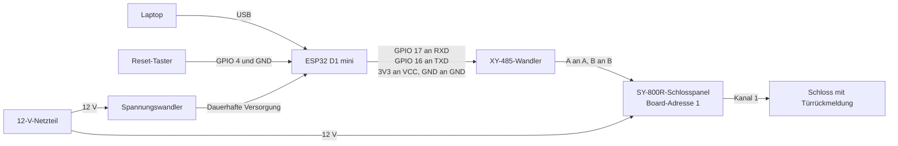

Am Ende dieser Seite erreicht der ESP32 das Schlosspanel über RS485, und der Reset-Taster ist
angeschlossen. Die Pins sind die Build-Standardwerte. Vom Prüfaufbau gibt es noch keine Fotos, die
Klemmenbezeichnungen also mit der Dokumentation der eigenen Boards abgleichen.

## Schaltplan

## ESP32 an RS485-Wandler

| ESP32 | XY-485 |
| --- | --- |
| GPIO 17 (UART 2 TX) | RXD |
| GPIO 16 (UART 2 RX) | TXD |
| 3V3 | VCC |
| GND | GND |

UART 0 führt die USB-Konsole und lässt sich nicht für den Bus nutzen. Andere Pins lassen sich mit
`idf.py menuconfig` unter **Locker RS485 serial line** einstellen.

## Wandler an Schlosspanel

1. A des Wandlers mit A des Panels verbinden, B mit B.
2. Die DIP-Schalter des Panels auf Board-Adresse 1 stellen. Wie die Schalter einer Adresse
   entsprechen, steht in der Dokumentation des Verkäufers zum Panel.

Die Firmware spricht standardmäßig mit 9600 Baud, 8N1. Das Panel des Prüfaufbaus antwortet mit diesen
Einstellungen in etwa 265 ms, bei einer Antwortfrist von 1500 ms. Die
[Referenz](/de/dokumentation/esp32/reference/#serielle-leitung-und-timing) nennt alle Einstellungen.

## Reset-Taster

Einen Taster von GPIO 4 nach GND anschließen. Die Firmware nutzt den internen Pull-up, ein Widerstand
ist nicht nötig. Einen anderen Pin unter **Locker reset button** in `idf.py menuconfig` einstellen.
Der Build lehnt Strapping-, Flash-, Input-only-, Konsolen- und RS485-Pins ab.

## Stromversorgung

- **Panel und Schlösser:** Das Panel des Prüfaufbaus hängt direkt an einem 12-V-Netzteil. Bei einem anderen Panel
  die Spannung in der Dokumentation des Verkäufers prüfen.
- **ESP32:** Am Prüfaufbau verbindet ein Spannungswandler den ESP32 mit demselben 12-V-Netzteil. Niemals
  12 V direkt an das ESP32-Board anschließen: Prüfen, ob die Ausgangsspannung des Spannungswandlers zum
  Versorgungspin des Boards passt. Modell und Kenndaten des Spannungswandlers sind noch nicht dokumentiert, und
  dies ist ein Prüfaufbau, keine entworfene Versorgung für einen Schrank.
- **USB:** Die Seiten zum Flashen und zum Bench-Test schalten die Panelversorgung aus, in diesen Schritten muss
  also USB den ESP32 versorgen. Vor dem gleichzeitigen Anschluss von USB und Spannungswandler die Dokumentation
  des Boards prüfen.
- **RS485-Wandler:** 3V3 des ESP32 versorgt den XY-485.
- **Freilaufdioden:** Die [Hardwareliste](/de/dokumentation/hardware/) empfiehlt beim Raspberry-Pi-Aufbau
  eine 1N4007 an jedem 12-V-Schloss. Ob dieses Panel sie braucht, wurde nicht getestet.

## Vor dem Einschalten

- [ ] Das Netzteil liefert gemessen 12 V, und das passt zu Panel und Schlössern.
- [ ] Die Ausgangsspannung des Spannungswandlers passt zum Versorgungspin des ESP32-Boards.
      Vor dem Anschluss des ESP32 nachmessen.
- [ ] A geht an A und B an B.
- [ ] RXD und TXD sind nicht vertauscht. GPIO 17 geht an RXD.
- [ ] VCC des Wandlers geht an 3V3, sein GND an GND des ESP32.
- [ ] Das Panel ist auf Board-Adresse 1 eingestellt.
- [ ] Hinter der Tür von Kanal 1 kann nichts beschädigt werden, wenn das Schloss freigibt.

Die Panelversorgung bis zum [Bench-Test](/de/dokumentation/esp32/bench-test/) ausgeschaltet lassen. Die
Firmware soll beim Booten nichts an das Panel senden, die zugehörige Hardwareprüfung hat aber noch kein
abgezeichnetes Ergebnis.

## Wenn der Bus stumm bleibt

Siehe [Fehlerbehebung](/de/dokumentation/esp32/troubleshooting/#symptom-ursache-lösung). Ein so
verdrahteter Wandler, dass er Anfragen nur als Echo zurückgibt, lässt alle Türen als offen erscheinen, und
Freigaben werden nie bestätigt.

## Weiter

[Firmware flashen](/de/dokumentation/esp32/flashing/).
