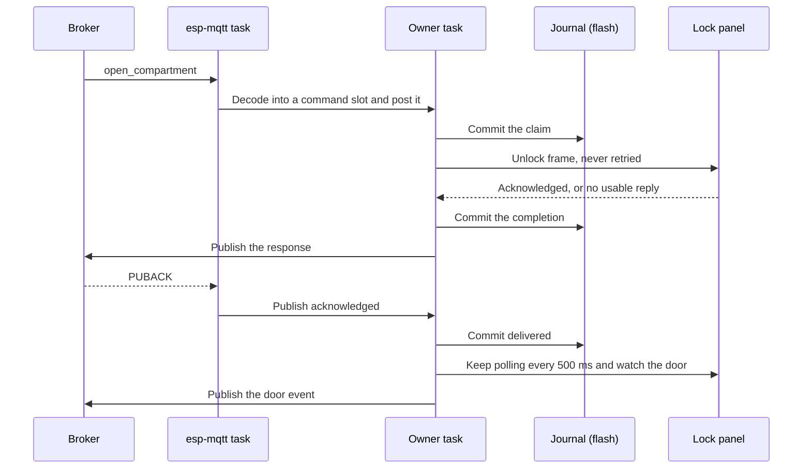
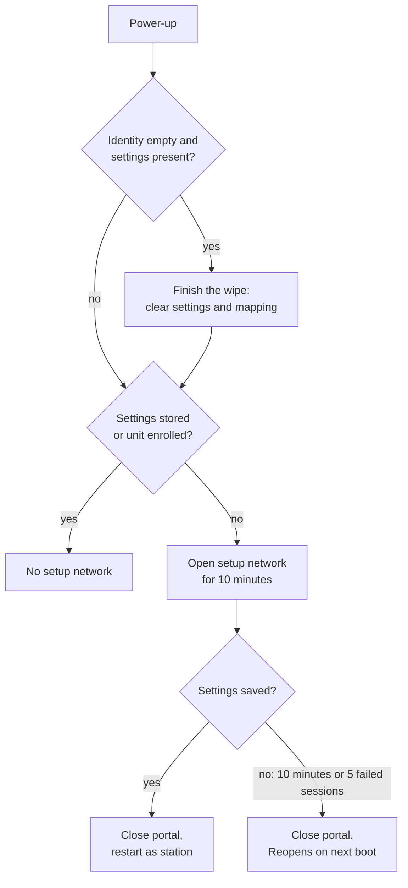

The firmware is hexagonal, like the Pi client
([ADR-0024](https://github.com/Open-Locker/Open-Locker/blob/main/docs/adr/0024-locker-client-v2-hexagonal-rewrite.md)): pure C use cases in the
middle reach every technology through ports. All use cases run on one task, one event at a time. The firmware shares the MQTT schemas and the panel's
golden frames with the Pi client, but no code.

This page holds the structure, formats and order of operations behind the decisions in the ADRs under `docs/adr/`. To build and test, see [Develop the ESP32 firmware](/dokumentation/esp32-development/).

## The path of one open



1. **The claim is durable before the unlock.** A claim left incomplete by a restart becomes an unknown-outcome response, never a second unlock.
2. **The unlock ends in one of four ways:** acknowledged, not sent, refused or outcome unknown. An unknown outcome still arms door detection, because the lock may have moved.
3. **The result is durable before it is published.** A repeated transaction ID replays the stored response with a fresh message ID, and sends nothing to the panel.
4. **Delivered means the broker has it.** Only the PUBACK marks a response as delivered, and the owner task goes on polling doors in the meantime.

The same path holds for every client: see
[Locker command scenarios](https://github.com/Open-Locker/Open-Locker/blob/main/docs/locker-command-scenarios.md).

## Layers and components

ESP-IDF components are the unit that enforces dependencies. `verify.py` checks the includes and the `REQUIRES` of each one.

```text
lc_domain        <- nothing
lc_ports         <- lc_domain
lc_application   <- lc_domain, lc_ports
adapters         <- lc_domain, lc_ports, their own SDK
main             <- everything
```

An adapter never requires another adapter. Where two must cooperate, the composition root passes one into the other through a small struct, as the bus
adapter gets its serial transport. There is one exception: `lc_softap_espidf` may drive the decisions of `lc_softap_portal`.

| Component | Kind | What it is |
| --- | --- | --- |
| `lc_domain` | Pure | Compartments, mapping and its hash, door detection, versions, errors |
| `lc_ports` | Pure, headers only | The port structs |
| `lc_application` | Pure | Use cases: commands, `apply_config`, state publishing, enrollment, commissioning, boot mode, updates |
| `lc_mqtt_codec` | Pure, with cJSON | Topics and JSON in both directions, fragment assembly |
| `lc_journal` | Pure | The command journal, over a flash I/O struct |
| `lc_rs485_lock_board` | Pure | Panel frame codec and bus adapter |
| `lc_button` | Pure | The reset gesture state machine |
| `lc_softap_portal` | Pure | Setup network decisions: window, one station, endpoints. Requires only `lc_domain`, so it has no path to the bus |
| `lc_serial_uart` | Adapter | UART transport for the bus adapter |
| `lc_usb_console` | Adapter | The console's line protocol, a driving adapter. Its line, command and setup parsing files are pure and are analysed |
| `lc_storage_nvs` | Adapter | Settings, identity and mapping stores; flash I/O of the journal partition |
| `lc_net_wifi` | Adapter | Wi-Fi station and SNTP |
| `lc_mqtt_espidf` | Adapter | MQTT transport. It only moves topics and bytes |
| `lc_ota_espidf` | Adapter | Updates through `esp_https_ota` and `esp_ota_ops` |
| `lc_softap_espidf` | Adapter | Access point and protocomm for the setup network |
| `main/` | Composition root | `app_main.c` wires adapters to ports. Also the owner task, the MQTT session and bench mode |

`main/mqtt_session.c` joins the transport to the codec, so no adapter depends on another. Pure components include no SDK or RTOS header, and build on a host unchanged.

## Ports

A port is a struct of function pointers with a context pointer, one struct per responsibility, in `components/lc_ports/include/lc_ports/`.

| Header | What it is for |
| --- | --- |
| `locker_bus_port.h` | Apply a profile, unlock, read door states, connection state. Protocol-neutral: wire protocol, channel numbering and polarity stay in the adapter |
| `outbound_port.h` | Typed messages out: response, heartbeat, snapshot, open detection, uncommanded open, offline, update failure |
| `command_journal_port.h` | Find, seen, claim, complete, delivered, and the open transactions |
| `store_ports.h` | Settings, identity and mapping stores |
| `provisioning_gateway_port.h` | Subscribe to the enrollment reply, send the registration |
| `firmware_update_port.h` | Running version, slot and trial state, start and abort a download, select the next slot, mark valid, roll back |
| `clock_port.h` | Monotonic milliseconds. Wall time stays inside the MQTT adapter |
| `hasher_port.h` | SHA-256 |
| `system_port.h` | Restart |

Outbound calls never wait for the broker. A call returns a publish ID if the adapter accepted the message, or `LC_PUBLISH_REFUSED`. The PUBACK, a failure or a timeout
arrive later as control events with that ID.

## Task model

Other tasks never call a use case. They post to the owner task's bounded inputs and never wait
([ADR-0080](https://github.com/Open-Locker/Open-Locker/blob/main/docs/adr/0080-esp32-owner-task.md)).

| Task | Runs |
| --- | --- |
| `owner` | Every use case, on a 100 ms tick |
| `lc_console` | The USB console. Bench `unlock` and `query` reach the bus directly |
| MQTT client | esp-mqtt. It decodes a command straight into a pool slot and posts it |
| Download | `lc_ota_espidf`, only during a download. It posts how the download ended |
| `button` | Samples the reset pin every 20 ms |

`main/bus_guard.c` puts a mutex around the bus port, so a console request and the owner task never overlap on the panel. The owner task only ever waits for a reply from the panel,
bounded by the bus deadline. On idle ticks it does the journal's background work, one sector erase or compaction at a time.

### The owner task's inputs

| Input | Size | When it overflows |
| --- | --- | --- |
| Control queue | 12-byte events, 32 deep | The event is lost and logged. A lost PUBACK leaves the response undelivered, and it is published again after 60 s |
| Command pool | 32 slots, decoded in place | The command is dropped and logged before anything is claimed, so it never unlocks. The backend times out |
| Setup mailbox | One slot | The sender is refused and told |
| Provisioning reply mailbox | One slot | The sender is refused and told |

Each step handles at most 32 control events, then the mailboxes, then one command, then its tick. A burst of acknowledgements cannot push out a command, and a full pool cannot lose an
acknowledgement. A `_Static_assert` in `main/owner_queue.h` fails the build if the inputs outgrow their 24 KiB budget.

A chip that hangs restarts: the task watchdog is set to panic in `sdkconfig.defaults`.

## Safety rules and their tests

Each rule is held by the host tests with the given prefix, in the catalogue in `locker-firmware/docs/testing.md`.

| Rule | Tests |
| --- | --- |
| An unlock is never retried. No unlock frame is sent at start-up or on reconnect, and wire channel zero (open all) is never generated | S1 |
| After a timeout, the bus stays silent for a settle period, so a late reply is not credited to the next request | S1 |
| The claim is durable before the unlock, the result before the response, and delivery only after the PUBACK | S2 |
| A corrupt journal record stops all actuation. A torn last record counts as never written, except a claim with an intact body, which stays open | S2 |
| `apply_config` cannot run during an unlock | S2 |
| The token is published only after the reply subscription is confirmed and the pending flag is stored. A lost reply never causes a second registration | S3 |
| Missing status bits and repeated failed polls report `unknown`, with no false door events after a reconnect | S4 |
| Bad commissioning input never saves partial settings | S5 |
| No path from the setup network reaches the bus port | S6 |
| No step of an update calls the bus unlock. The next slot is selected only after verification | S7 |

## Known risks

- **Late replies.** The panel protocol has no request ID. The settle period only covers replies inside the panel's worst reply time, which hardware check HW-A9 is meant to measure. The bench
  has measured about 265 ms; the 200-unlock run is deferred.
- **Flash under power loss.** Host tests cut journal writes and erases at every byte. Real flash can still fail differently.
- **RAM.** The journal index, MQTT buffers and TLS share a few hundred kilobytes. See [Flash & RAM](/dokumentation/esp32/memory/).
- **Drift from the Pi client.** There are two implementations of one contract. The shared schemas and golden frames are the controls.
- **Adapters without host tests.** `lc_serial_uart`, `lc_net_wifi`, `lc_storage_nvs` and most of `main/` are checked only on the bench.

## What maps to what in the Pi client

| Pi client (`locker-client/src/`) | ESP32 firmware (`locker-firmware/`) |
| --- | --- |
| `domain/compartment.ts`, `config.ts` | `lc_domain/compartment.h`, `config.c` |
| `domain/door-detection.ts` | `lc_domain/door_detection.c` |
| `domain/errors.ts` | `lc_domain/errors.h` (the strings live in the codec) |
| `ports/locker-bus.port.ts` | `lc_ports/locker_bus_port.h` |
| `ports/mqtt.port.ts`, `DedupStorePort` | `lc_ports/command_journal_port.h` |
| `ports/mqtt.port.ts`, `OutboundMqttPort`, `door-events.port.ts` | `lc_ports/outbound_port.h` |
| `ports/config.port.ts` | `lc_ports/store_ports.h`, `clock_port.h` |
| `application/open-compartment.ts` | `lc_application/open_compartment.c` |
| `application/apply-config.ts` | `lc_application/apply_config.c` |
| `application/state-publishing.ts` | `lc_application/publish_state.c` |
| `application/provision-device.ts` | `lc_application/provision_device.c` |
| `adapters/mqtt/command-dispatcher.ts`, `inbound-protocol-guard.ts` | `lc_application/handle_command.c` |
| `adapters/mqtt/outbound-envelope.ts`, `domain/mqtt-parsing.ts` | `lc_mqtt_codec/` |
| `adapters/rs485/rs485-lock-board-codec.ts` | `lc_rs485_lock_board/codec.c` |
| `adapters/rs485/rs485-lock-board-bus-actor.ts` | `lc_rs485_lock_board/bus.c` |
| `adapters/rs485/serialport-transaction.transport.ts` | `lc_serial_uart/` |
| `adapters/mqtt/dedup-store.ts` | `lc_journal/` |
| `bootstrap/createApp.ts` | `main/app_main.c` |

The command guard lives in the application layer here, because the claim must be durable before any side effect and the journal is the dedup store. `commission_device.c` has no Pi counterpart.

## Command journal

Decided in ADR-0070 and ADR-0081.

### Region header

The `journal` partition is split into two regions of 128 KiB. A region starts with 16
bytes, written after all its records:

| Offset | Size | Content |
| --- | --- | --- |
| 0 | 4 | Magic `OLJR` |
| 4 | 1 | Format version `0x01` |
| 5 | 3 | `0xFF` |
| 8 | 4 | Generation, little endian, 1 to `0xFFFFFFFE` |
| 12 | 4 | CRC-32 (IEEE) of bytes 0 to 11, little endian |

At start:

- One valid header: that region is active.
- Two valid headers: the higher generation is active. Equal generations mark the
  journal unhealthy.
- No valid header, and nothing programmed outside the first 16 bytes of region A: an
  empty journal. The first append writes generation 1 to region A.
- No valid header and any record byte programmed: the journal is unhealthy.

Each compaction erases one region, so the flash wears out after about 200,000
compactions
([ADR-0081](https://github.com/Open-Locker/Open-Locker/blob/main/docs/adr/0081-esp32-command-journal-retention.md)),
far below a wrap of the generation.

### Record, version 1

Records follow from offset 16:

| Offset | Size | Content |
| --- | --- | --- |
| 0 | 1 | Magic `0xA7` |
| 1 | 1 | Format version `0x01` |
| 2 | 1 | Type: 1 claim, 2 completion, 3 delivered, 4 message |
| 3 | 2 | Payload length, little endian, at most 320 |
| 5 | 1 | Header check: CRC-8 (polynomial 0x07) of bytes 1 to 4 |
| 6 | n | Payload |
| 6 + n | 4 | Record check: CRC-32 (IEEE) of bytes 1 up to the end of the payload, little endian |
| 10 + n | 1 | Commit marker `0xC3` |

The payload is a sequence of length-prefixed texts (one length byte, then the bytes, at
most 128 and no NUL) and single bytes:

- claim: transaction ID, message ID, action name;
- completion: transaction ID, action name, error code (one byte), applied config hash
  (empty unless an `apply_config` succeeded);
- delivered: transaction ID;
- message: transaction ID, a further message ID for it.

The largest record is 331 bytes. The checks do not cover the record's position, so a
record can be copied unchanged into another region. A failed write or erase marks the
journal unhealthy in memory until the next start.

### Reading

At start the active region is scanned from offset 16:

1. `0xFF` where a record would start ends the log when every byte after it is `0xFF`.
   With programmed bytes after it, it is a damaged header (rule 3 or 4).
2. A record that passes every check and ends in `0xC3` is committed.
3. The tail is torn, not corrupt, when it does not end in a valid `0xC3` marker: its
   marker is erased or partly programmed, or its header is damaged and the last programmed
   byte lies within 331 bytes of its start. A torn claim whose body passes its CRC-32 is
   kept as an open claim, because a bit error in its marker reads the same as a cut
   write. The next compaction copies it with a marker.
4. Everything else marks the journal unhealthy: a damaged record followed by any
   programmed byte, a record that ends in `0xC3` but fails a check, an unknown version or
   type, and an intact record that makes no sense (a claim for a known ID, a completion or
   delivery for a transaction not in that state, an unknown error code).

Torn debris is never overwritten: the next append first compacts, which leaves it in the
old region.

### Moving to the other region

1. The records to keep are copied byte for byte into the spare, after its header space,
   in log order.
2. The spare's header is written with generation + 1. From this write on, the new region
   is active.
3. The old region's header sector is erased at once. The rest is erased ahead of time as
   the next spare, one sector per idle tick, and read back: it is ready only if every byte
   reads `0xFF`. A blank check that fails twice marks the journal unhealthy. After a restart
   the spare is read once, and a blank one is not erased again, so a boot loop does not wear
   out the flash.

A power cut before step 2 leaves the old region active and the half-written spare without a
header; it is erased again. A power cut between steps 2 and 3 leaves two valid headers, and
the higher generation wins.

### Index in RAM

A scan builds an index of about 15 KiB, allocated statically, that holds no ID texts and no
responses: for each transaction an 8-byte FNV-1a hash of its ID, its state, the flash offsets
of its claim and completion, and record sizes; for each message ID a hash, its transaction
and an offset. A hash match is confirmed by reading the record from flash, so a collision is
just a mismatch. A failed read marks the journal unhealthy.

### Recovering an unhealthy journal

```bash
parttool.py --port <port> --partition-table-offset 0xC000 erase_partition --partition-name journal
```

Then commission the device again.

## Setup network and reset

Decided in ADR-0074 and ADR-0083.

### Boot mode

`lc_boot_decide()` runs first at every start:



A unit without settings is in bench mode whether or not its setup network is open, and the setup network
stays closed if the `lc_setup` namespace holds no secrets. No default password stands in.

### `ol-config` payload

The custom endpoint carries what the Wi-Fi endpoint cannot: one version byte (`1`), then tag-length-value items
with a one-byte tag and a one-byte length. The tags are `1` broker URL (up to 192 bytes), `2` bootstrap user, `3` bootstrap
password and `4` token (up to 128 bytes each). No field may be empty or hold a NUL. The reply is one status byte, the same for
every refusal, encrypted like the request. The tool sends `ol-config` first, because the Wi-Fi part makes the unit commission itself.

### Wipe order and boot repair

- A reset writes the empty identity first and, if that fails, wipes nothing. It then tries
  to clear both mapping and settings, and returns a distinct "partial" result when one of
  those fails.
- At boot, an empty identity with settings present is not a state any normal path creates.
  The boot logic finishes the wipe, then decides the mode. The same rule repairs a failed
  rollback in `commission_apply`.
- An empty identity with a mapping and no settings is a valid bench state and is left alone.
- If the settings clear works but the mapping clear fails, the unit keeps a stale mapping that
  cannot be told from a bench mapping. The backend marks a reset bank's configuration dirty and
  sends a fresh `apply_config` after enrollment, and the partial result is logged.

### Installer tool

For the pilot, installers use `scripts/commission.py --softap`. It uses the `esp_prov` of the
`network_provisioning` copy in the firmware's `managed_components/`, so tool and firmware always
come from the same build, and reads the Security 2 patch level from the unit's `proto-ver`
reply. It reads secrets without echo, never writes them to disk and never resends after a lost
connection.

### Bench spike of 2026-10-21

Run once with ESP-IDF 6.1, network_provisioning 3.0.0 and an ESP32 rev 3.1 with 4 MB flash, on a
development build. It is a spike, not the group F acceptance run.

| Question | Result |
| --- | --- |
| Does `esp_prov` talk to our protocomm endpoints and carry `ol-config`? | Holds. `commission.py --softap` ran `proto-ver`, the Security 2 session (patch level 1), `ol-config` and `prov-config` against an erased unit, which saved, joined the Wi-Fi, enrolled, applied its config and opened a compartment from the admin panel |
| Is `ol-config` encrypted by the session? | Holds. Every TCP byte the tool sent and received was recorded on the client, with made-up values. None of the seven values appears, as UTF-8 or UTF-16. `ol-config` is 90 bytes for a 74-byte payload (a 16-byte tag). Only `proto-ver` is in clear. The capture was taken above WPA2 |
| Free heap with the portal running? | Enough; AP-only stays. Lowest over a full session: 99,268 bytes in AP-only, 97,600 in AP+STA. Largest free block 98,304. Sampled every 2 s, so the last seconds before the restart are not covered |
| ESP-IDF 6.1 on the lwIP DHCP-server advisory (GHSA-g764-gwc3-75m5, CVE-2026-45160)? | Fixed in 6.1. No further pin |
| Does a jumper from GPIO 4 to GND held for 10 s read as a press? | Not run yet |

## OTA update on the device

:::note[Planned]
Over-the-air updates are not implemented yet. They come with [#336](https://github.com/Open-Locker/Open-Locker/pull/336), once the image
signing design is settled. This section describes the plan.
:::

Decided in ADR-0075.

### Order of an update

1. **Idle check.** The command is journaled like any other, so a repeat with the same
   transaction ID does not download twice.
2. **Version policy.** Before starting a download the application refuses a version equal to the
   running one, a lower one without `allow_downgrade`, and one this unit rolled back before; and
   it refuses when it cannot compare the running version. The comparison is semantic versioning,
   and `PROJECT_VER` comes from the release tag.
3. **Download.** The image header is read through `esp_https_ota_get_img_desc()` after `begin` and
   before any byte is written. A header that cannot be read is a failed transfer, and a version
   different from the command's is a failed verification.
4. **Slot selection.** `esp_https_ota_finish` verifies the image and calls
   `esp_ota_set_boot_partition` itself, so the adapter never calls it. If the journal cannot store
   the answer after the download started, the application aborts the download: nothing is published
   that the journal does not hold.
5. **Restart.** Once a door is no longer being watched. Responses not yet acknowledged do not hold it
   back; the journal sends them again after the restart. Opens arriving during the download are served
   by the owner task as usual.
6. **Trial.** The new image boots on trial and marks itself valid, or goes back
   ([ADR-0085](https://github.com/Open-Locker/Open-Locker/blob/main/docs/adr/0085-esp32-trial-boot-and-rollback.md)).

### The version "rolled back before"

The firmware does not store it. It is the version of the slot the bootloader last marked invalid
or aborted (`esp_ota_get_last_invalid_partition()`), which also covers a crash, a watchdog reset or
a power cut during a trial. The record is gone once the next download erases that slot, and then the
same version may be tried again.

### Logging

The adapter logs the version only, silences the `HTTP_CLIENT` log tag during a download because the
HTTP client prints the whole URL when it cannot parse it, and clears its copy of the URL when the
download ends.

## Firmware rollout in the backend

:::note[Planned]
The backend rollout is not implemented yet. It comes with over-the-air updates in
[#336](https://github.com/Open-Locker/Open-Locker/pull/336). This section describes the plan.
:::

Decided in ADR-0077.

### Requests and refusals

The admin action "Update firmware" (`lockerbank.configure`) calls
`LockerService::requestFirmwareUpdate()`, which records `FirmwareUpdateRequested` (locker, release
ID, version, transaction ID, `allow_downgrade`, actor). A reactor publishes `update_firmware` through
a typed publisher. A request is refused for:

- a bank that is not provisioned;
- a bank whose heartbeat did not advertise `firmware_update`;
- an update already in flight;
- a release marked invalid;
- a version the bank already reports (`already_running`), because a heartbeat could not tell an update
  to the running version from no update at all;
- a download link the firmware would refuse: not `https://`, or over 256 characters.

### Status

The status is *requested*, *downloading*, *completed* or *failed*, written by a projector onto firmware
columns of `locker_banks`. It acts only for the transaction the bank tracks, so a late or old event for
another transaction is history.

| From | Trigger | To |
| --- | --- | --- |
| *requested* | Success response, derived in `CommandResponseReactor` | *downloading* |
| In flight | Error response, or `firmware_update_failed` derived in `FirmwareUpdateReactor` | *failed*, with the code |
| In flight | Heartbeat with the target version and `trial: false` (`FirmwareUpdateCompleted`) | *completed* |
| *downloading* | Heartbeat with `last_rollback_version` equal to the target (`FirmwareUpdateFailed`, reason `rollback`) | *failed* |
| In flight | No outcome 30 minutes after the request (`FirmwareUpdateFailed`, reason `timeout`) | *failed* |

- Completion is also valid from *requested*, when the device finished before the accepted message
  arrived.
- Rollback counts only while *downloading*. Before acceptance a unit that rolled this version back
  earlier still reports it, and the device refuses the version itself.
- A response counts only for an update this backend requested from that bank.
- An update that already timed out stays failed even if its heartbeat arrives later.
- The failure reason is a separate `reason` field beside `errorCode`, which keeps the device's
  `UPDATE_*` codes.
- `FirmwareUpdateOutcomeService` derives completion and rollback.

### Heartbeat fields

`LockerHeartbeatHandler` writes `firmware_version`, `firmware_trial`, `firmware_running_slot`,
`firmware_last_rollback_version`, `firmware_reported_at` and `firmware_update_capable` (from
`capabilities`) to `locker_banks`, as it does `modbus_connected`. A heartbeat without them leaves the
stored values alone, and `capabilities` without `firmware_update` clears the capability.

If any field is malformed, including `trial` missing with `firmware_version`, the last heartbeat,
connection state and Modbus fields are still updated. A warning names the fields but not the payload.

### Admin screens

The locker bank list shows the reported version and the update status. The edit view shows slot, trial,
last rollback version, target, error code and failure reason. "Update firmware" has a release picker and
an `allow_downgrade` toggle, appears only for banks that reported the capability, and shows a refusal as
a translated notification. Managers do not see it.
