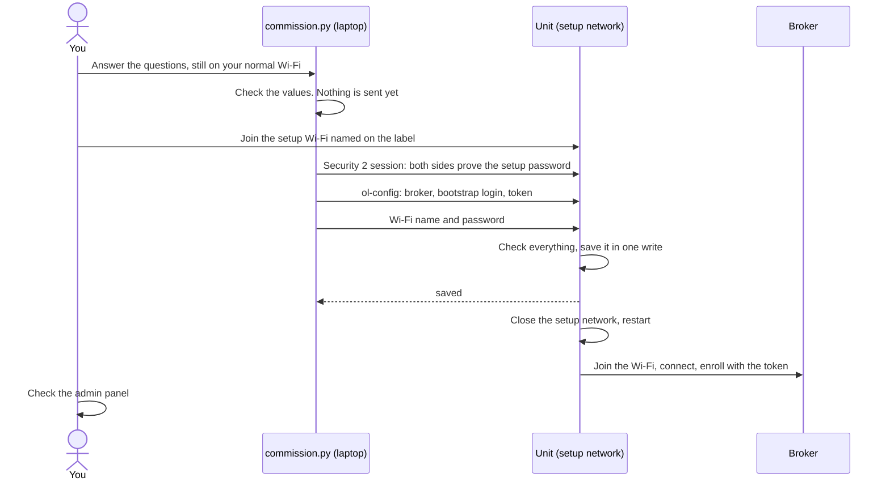

Commissioning gives a unit its Wi-Fi settings, the broker address and a one-time token. The
unit then enrolls itself and appears as online in the admin panel. Run the tool once per unit,
from a laptop.

:::caution[Not passed yet]
Commissioning over the setup Wi-Fi has run once on a development build. The hardware checks of
group F have not passed, and credentials are stored unencrypted on the chip, so do this on a
supervised bench only.
:::

## Before you start

- A flashed unit. For the setup Wi-Fi, it also needs its
  [setup secrets and label](/dokumentation/esp32/flashing/#write-the-setup-secrets).
- An admin account on the backend, with the `lockerbank.configure` permission.
- The tool's dependencies, installed once from `locker-firmware/`:

  ```bash
  pip install -r requirements.txt
  ```

- From your backend's administrator:
  - The broker URL, for example `mqtts://mqtt.example.com:8883`. The certificate must chain to a
    public CA. A plain `mqtt://` URL needs a
    [development build](/dokumentation/esp32/flashing/#choose-a-build).
  - The bootstrap user and password: the backend's `MQTT_PROVISIONING_USERNAME` and
    `MQTT_PROVISIONING_PASSWORD`.

## Prepare the admin panel

There are no screenshots of these steps yet. The labels below come from the panel's source.

1. Under **Locker banks**, create a locker bank. Set **Hardware adapter** to
   **RS485 locker board**, and **Lock feedback polarity** to
   **Active signal means door closing** for the bench panel.
2. Add the compartments. For each, set **Number**, **Slave ID** (the panel's board address, `1`)
   and **Address** (0-based, so channel 1 is `0`). The unit takes one board address per bank.
3. Choose **Issue provisioning token**, then **Issue token** to confirm.
4. Copy the token from the dialog. It is valid for **24 hours**, works **once**, and is not
   shown again. If you lose it, choose **Restart provisioning** to get a new one.

## Over the setup Wi-Fi (recommended)

A unit with no settings opens its setup network on every power-up, for 10 minutes. The name and
password are on its label. The tool asks its questions while your laptop is still on its normal
network, so you can check the broker before you switch.



*UML sequence diagram: the setup password is never sent, and the settings travel inside the
encrypted session.*

1. Build the firmware in this checkout, if you have not. The tool uses the `esp_prov` from the
   build's `managed_components/` folder, so tool and firmware always match. `esp_prov` also needs
   two more Python packages:

   ```bash
   pip install cryptography protobuf
   ```

2. Start the tool:

   ```bash
   python scripts/commission.py --softap
   ```

3. Enter the **setup password** from the label.
4. Enter the **Wi-Fi name** and **password** of the network the unit will use. Leave the password
   empty for an open network. Then enter the **broker URL**, the **bootstrap user** and
   **password**, and the **one-time provisioning token**.

   Secrets are read without echo, and nothing secret is written to disk. The Wi-Fi name and the
   broker URL are kept in `~/.openlocker.json` as the next run's defaults.

5. Check the summary and confirm. If the tool says `Nothing answers at ...` from your laptop, the
   broker may still be reachable from the unit's network, and you can continue.
6. Power-cycle the unit if it has been on for more than 10 minutes. When the tool says
   `Join the unit's setup Wi-Fi now`, join the network named on the label. The tool waits up to
   3 minutes for the unit.
7. You should see `Settings saved. The device now joins the Wi-Fi and enrolls.` The setup network
   closes, and your laptop drops off it.

The unit only ever tells the tool "saved". Whether it joined the Wi-Fi and enrolled shows in the
admin panel, as described [below](#check-that-it-worked).

## Over USB (release and development builds)

Plug the board in. A production build refuses
it.

```bash
python scripts/commission.py --usb
```

The tool finds a board with a CH9102 USB-serial chip. For any other chip, or if it finds none, name
the port: `--usb COM3` or `--usb /dev/ttyUSB0`. Close any serial monitor first, or the port is busy.

It asks the same questions, except the setup password. On an enrolled unit it asks only for Wi-Fi
name, password and broker, and keeps identity, mapping and journal.

You should see `Settings saved. The device restarts, joins the network and connects to the broker.`

## Check that it worked

On the locker bank in the admin panel:

- **Provisioning token status** shows **Consumed**, and **Provisioned at** has a time.
- **Status** in the list shows online.
- **Config status** shows **Clean (confirmed by client)**: the backend sent the mapping and the unit
  confirmed it.

Then [verify the bank end to end](/dokumentation/esp32/verify/).

## The token is used once

The unit stores "enrollment pending" before it sends the token, so it never sends the same token
twice, whatever happens next.

- **The Wi-Fi settings were wrong, so the token was never sent:** the unit keeps retrying the
  Wi-Fi. [Reset it](/dokumentation/esp32/maintenance/#reset-a-unit) and commission it again. The
  same token still works within its 24 hours.
- **The reply was lost, or the backend refused the token:** the unit does not retry. After a restart
  it still listens for a late reply, and enrolls if one arrives. Otherwise it refuses new settings
  until it is reset. Choose **Restart provisioning** in the panel, reset the unit, and commission it
  with the new token.
- **The tool lost its connection after sending:** nothing is resent, because the settings may or may
  not have been saved. Check the admin panel, or run `status` on the console, before you try again.

## Commissioning record

Keep one record per unit. Never write the label's secrets or the token here. They are the only
copies on purpose.

| Field | Value |
| --- | --- |
| Locker bank | |
| Label Wi-Fi name (not secret) | |
| Where the label is | |
| Firmware version and image SHA-256 | |
| Signing key used (bench or release) | |
| Date | |
| Operator | |

## If it did not work

See [Troubleshooting](/dokumentation/esp32/troubleshooting/#symptom-cause-fix).

## Next

[Verify end to end](/dokumentation/esp32/verify/).
