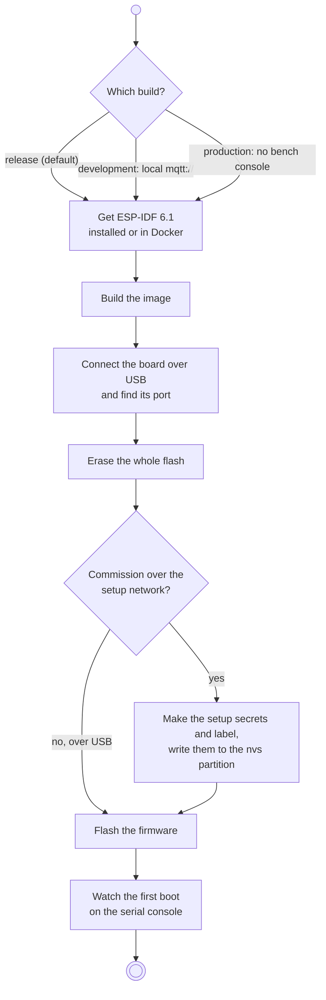
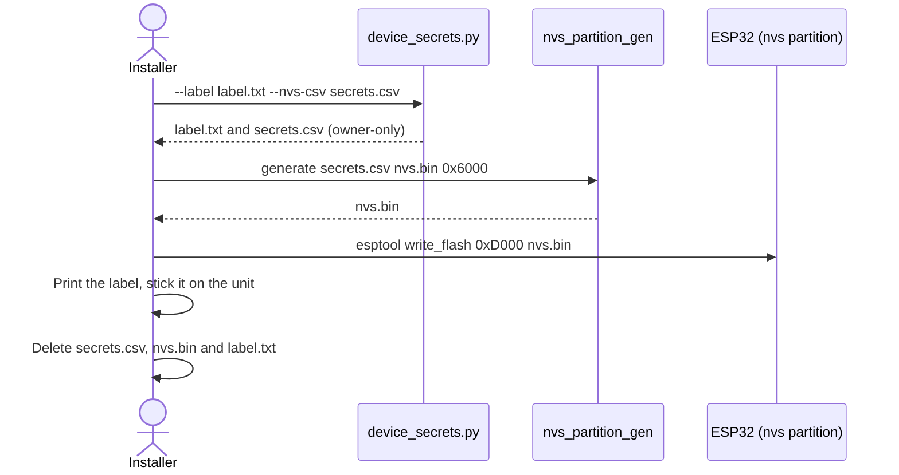
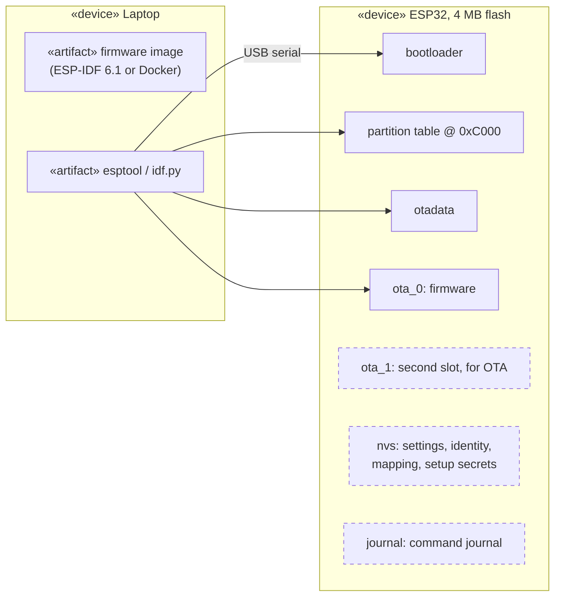

This page takes a new ESP32 from blank to booted Open Locker firmware. A unit
that will be commissioned over the setup network also gets its own setup
secrets and a label. Commissioning itself is the
[next step but one](/dokumentation/esp32/commissioning/), after the
[bench test](/dokumentation/esp32/bench-test/).

:::caution[Bench firmware]
No build has flash or NVS encryption yet. Wi-Fi password, broker credentials
and setup secrets are stored in clear on the chip. Do not leave a flashed unit
where anyone can reach it.
:::

## The whole procedure



*UML activity diagram. Each step is a section below.*

## Before you start

- **The board:** an ESP32 D1 mini or another ESP32 (target `esp32`) with
  **4 MB flash**. The flash layout assumes exactly that.
- **A USB data cable.** Many cheap cables only charge. If the laptop does not
  see a new serial port when you plug the board in, try another cable first.
- **A USB-serial driver**, if your system needs one. These boards use a
  CH340, CH9102 or CP210x chip; Linux has the drivers built in, Windows and
  macOS may need the vendor's driver.
- **Python 3** and the firmware's tools, once per laptop:

  ```bash
  git clone https://github.com/Open-Locker/Open-Locker.git
  cd Open-Locker/locker-firmware
  pip install -r requirements.txt
  ```

All commands on this page run in `locker-firmware/`.

:::tip[Keep the lock unpowered]
The firmware is designed to send nothing to the lock panel while it boots, but
that is only confirmed once the hardware checks pass. Until then, leave the
lock panel's supply off while you flash.
:::

## Prebuilt firmware

:::note[Not available yet]
There are no published firmware images yet. CI builds the image but does not
release it, so build it yourself as below. Once releases exist, this section
will offer a flasher that runs in the browser and needs nothing installed.
:::

## Choose a build

There is one source tree and three configurations. They differ in what the
unit accepts, not in how you flash it.

| Build | Use it for | Plain `mqtt://` broker | Bench console commands |
| --- | --- | --- | --- |
| **Release** (default) | Every unit that talks to a real backend | Refused, `mqtts://` only | Yes |
| **Development** | A local backend with a plain MQTT broker | Allowed | Yes |
| **Production** | Units commissioned only over the setup network | Refused | No: `configure`, `unlock`, `command` and `reset-network` are left out |

The bench console commands are what the [bench test](/dokumentation/esp32/bench-test/)
and USB commissioning use. A production build can only be commissioned over
the setup network.

:::caution
A production build is **not** releasable yet: it still lacks flash and NVS
encryption.
:::

## Get the toolchain

Pick one.

**ESP-IDF installed.** Follow Espressif's
[getting started guide for ESP-IDF 6.1](https://docs.espressif.com/projects/esp-idf/en/v6.1/esp32/get-started/)
and open an ESP-IDF shell (on Windows the "ESP-IDF 6.1 PowerShell" shortcut).
Every `idf.py` and `esptool.py` command below runs in it.

**Docker, nothing installed.** The `espressif/idf:v6.1` image builds the
firmware. Docker on Windows and macOS cannot reach the USB port, so you flash
with `esptool`, which you install once with `pip install esptool`.

## Build the image

The first build fetches the firmware's dependencies and takes a few minutes.

| Build | ESP-IDF shell |
| --- | --- |
| Release | `idf.py build` |
| Development | `idf.py -D SDKCONFIG_DEFAULTS="sdkconfig.defaults;sdkconfig.dev" build` |
| Production | `idf.py -D SDKCONFIG_DEFAULTS="sdkconfig.defaults;sdkconfig.production" build` |

With Docker, put the same `idf.py` command after
`docker run --rm -v "$PWD:/project" -w /project espressif/idf:v6.1`, for
example:

```bash
docker run --rm -v "$PWD:/project" -w /project espressif/idf:v6.1 idf.py build
```

In PowerShell, write `${PWD}` instead of `$PWD`.

:::caution[Switching builds]
Delete the file `sdkconfig` (and the `build/` folder) before you build another
configuration. Otherwise the values of the previous build stay, and for example
a release build keeps accepting `mqtt://`, or a development build keeps
refusing it.
:::

## Connect the board

Plug the board in and find its serial port:

| System | Port | Where to look |
| --- | --- | --- |
| Windows | `COM3`, `COM4`, … | Device Manager → Ports (COM & LPT) |
| Linux | `/dev/ttyUSB0` or `/dev/ttyACM0` | `ls /dev/tty{USB,ACM}*`; add yourself to the `dialout` group if access is denied |
| macOS | `/dev/cu.usbserial-…` or `/dev/cu.wchusbserial-…` | `ls /dev/cu.*` |

The examples below use `COM3`; put your port in its place.

Check that the board has 4 MB flash:

```bash
esptool.py --port COM3 flash_id
```

The output should say `Detected flash size: 4MB`.

## Erase the flash

A new unit starts from an empty chip:

```bash
idf.py -p COM3 erase-flash
```

:::danger[Erasing an enrolled unit]
Erasing removes everything: Wi-Fi settings, the unit's MQTT identity, the
compartment mapping and the command journal. An enrolled unit can no longer
connect afterwards. Reset the locker bank's provisioning in the admin panel and
commission the unit again with a new token. To **update** the firmware of a
unit in service, skip this step: flashing alone keeps its settings (see
[What flashing changes](#what-flashing-changes)).
:::

## Write the setup secrets

Only for a unit you will commission over the setup network. Skip this section
for USB commissioning.

Every unit gets its own setup Wi-Fi name, Wi-Fi password and setup password.
They are made on your laptop, written into the unit's `nvs` partition, and
printed on a label. The label is the only copy: nothing else stores them.



*UML sequence diagram: the secrets go from your laptop to the unit and the
label, and nowhere else.*

1. Make the secrets. The tool refuses to overwrite existing files.

   ```bash
   python scripts/device_secrets.py --label label.txt --nvs-csv secrets.csv
   ```

2. Turn them into an image of the `nvs` partition (24 KiB, `0x6000`):

   ```bash
   python -m esp_idf_nvs_partition_gen generate secrets.csv nvs.bin 0x6000
   ```

   The generator comes with ESP-IDF. With Docker, run this command in the
   container, the same way as the build.

3. Write the image to the unit. `0xD000` is where the `nvs` partition starts;
   the flash layout is fixed, so this address never changes.

   ```bash
   esptool.py --port COM3 write_flash 0xD000 nvs.bin
   ```

   With Docker, run it as `python -m esptool` instead of `esptool.py`.

4. Print `label.txt` and stick it on the unit, where an installer will find it.
5. Delete `secrets.csv`, `nvs.bin` and `label.txt`.

:::caution
Writing the `nvs` partition replaces everything in it. Only do it on a unit
with no settings yet, right after the erase.
:::

## Flash the firmware

**ESP-IDF shell**, right after the build:

```bash
idf.py -p COM3 flash
```

**Docker build**, flashed with `esptool` from the `build/` folder:

```bash
cd build
python -m esptool --chip esp32 -p COM3 -b 460800 write_flash "@flash_args"
```

`flash_args` is written by the build and lists every file with its address.

If it fails with `Failed to connect`, hold the board's **BOOT** button (if it
has one) while the tool connects, or add `-b 115200` for a slower, more
forgiving speed.

## Watch the first boot

```bash
idf.py -p COM3 monitor
```

The console runs at 115200 baud; leave it with `Ctrl+]`. Without ESP-IDF, any
serial terminal at 115200 baud works.

The boot log shows what the unit will do next:

- **With setup secrets**, it opens its setup network for 10 minutes. The Wi-Fi
  name from the label shows up in your laptop's network list.
- **Without network settings**, the console stands in for the broker: this is
  bench mode, where the [bench test](/dokumentation/esp32/bench-test/)
  continues.

On a release or development build, type `status` and press Enter. What you
type is not echoed; the reply is one line starting with `ok`. A fresh unit
reports that it is not enrolled and has no settings stored.

## What flashing changes



*UML deployment diagram. Solid boxes are written by every flash; dashed boxes
are kept.*

| What you run | Replaces | Keeps |
| --- | --- | --- |
| `idf.py flash` (or `write_flash @flash_args`) | Bootloader, partition table, `otadata`, firmware in `ota_0` | `nvs` (settings, identity, mapping, setup secrets) and `journal` |
| `idf.py erase-flash` | Everything | Nothing |
| `write_flash 0xD000 nvs.bin` | All settings and the setup secrets | Everything else |

So flashing a new firmware version onto a unit in service keeps it enrolled and
configured. There are no over-the-air updates yet; every update goes over USB.

## If something goes wrong

| Symptom | Cause | Fix |
| --- | --- | --- |
| No new serial port appears | Charge-only cable, or missing USB-serial driver | Try another cable; install the driver for the board's chip |
| `Permission denied` on the port (Linux) | Not in the `dialout` group | `sudo usermod -aG dialout $USER`, then log in again |
| `Failed to connect to ESP32` | Board did not enter download mode | Hold **BOOT** while connecting, or use `-b 115200` |
| Flash size is not 4 MB | Different board | Use a board with 4 MB flash; the layout cannot change |
| `mqtt://` refused, or accepted when it should not be | Old `sdkconfig` from another build | Delete `sdkconfig` and `build/`, build again |
| Boot log reports the journal as unhealthy | Leftovers from an earlier firmware | Erase the flash and start again |

More in [Troubleshooting](/dokumentation/esp32/troubleshooting/).

## For developers

The full gate run, host tests and the target build are described in the
firmware's [README](https://github.com/Open-Locker/Open-Locker/blob/main/locker-firmware/README.md#build-and-test)
and [testing guide](https://github.com/Open-Locker/Open-Locker/blob/main/locker-firmware/docs/testing.md).
The flash layout is fixed by
[ADR-0069](https://github.com/Open-Locker/Open-Locker/blob/main/docs/adr/0069-esp32-locker-firmware.md),
the setup secrets by
[ADR-0074](https://github.com/Open-Locker/Open-Locker/blob/main/docs/adr/0074-esp32-softap-provisioning.md).
