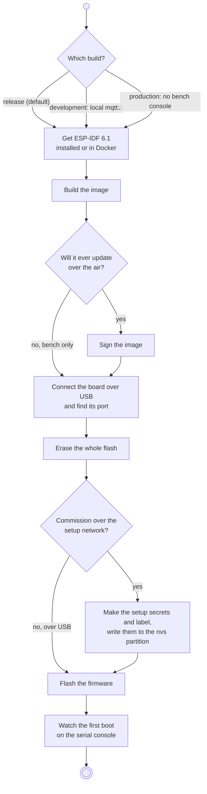
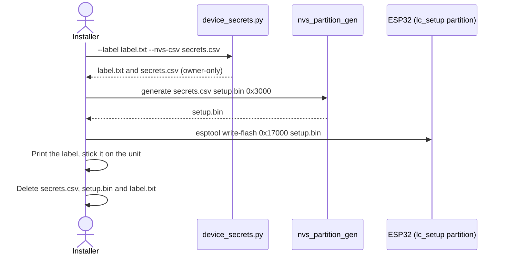
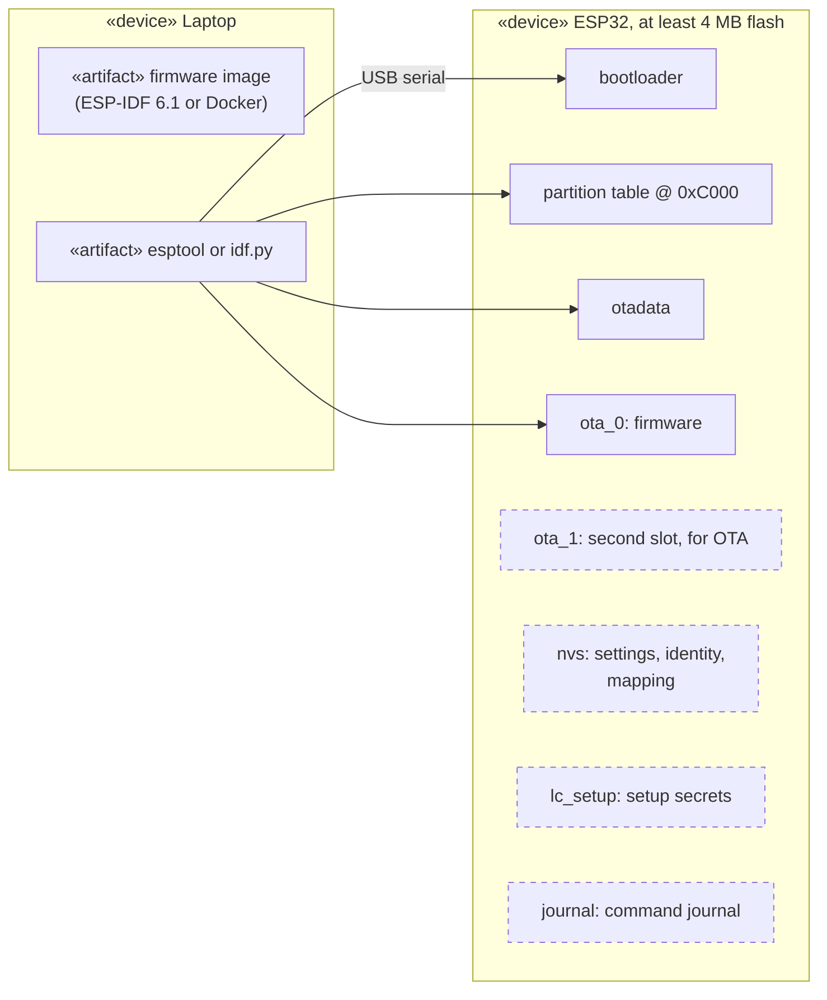

This page takes a new ESP32 from blank to booted Open Locker firmware. A unit
that will be commissioned over the setup network also gets its own setup
secrets and a label. Commissioning itself is the
[next step but one](/dokumentation/esp32/commissioning/), after the
[bench test](/dokumentation/esp32/bench-test/).

:::caution[Bench firmware]
No build has flash or NVS encryption yet. Wi-Fi password, broker credentials
and setup secrets are stored in clear on the chip. Do not leave a flashed unit
where anyone can reach it.
:::

## The whole procedure



*UML activity diagram. Each step is a section below.*

## Before you start

- **The board:** an ESP32 D1 mini or another ESP32 (target `esp32`) with
  **at least 4 MB flash** and chip **revision 3.0 or later**. The flash layout
  uses the first 4 MB, and the firmware's image signing needs that revision.
  See [Choose a chip](/dokumentation/esp32/parts/#choose-a-chip).
- **A USB data cable.** Many cheap cables only charge. If the laptop does not
  see a new serial port when you plug the board in, try another cable first.
- **A USB-serial driver**, if your system needs one. The bench board uses a
  CH9102 chip. Linux has the driver built in; Windows and macOS may need the
  vendor's driver.
- **Python 3** and the firmware's tools, once per laptop:

  ```bash
  git clone https://github.com/Open-Locker/Open-Locker.git
  cd Open-Locker/locker-firmware
  pip install -r requirements.txt
  ```

All commands on this page run in `locker-firmware/`.

:::tip[Keep the lock unpowered]
The firmware is designed to send nothing to the lock panel while it boots, but
the hardware check for that has no signed-off result. Leave the lock panel's
supply off while you flash.
:::

## Prebuilt firmware

:::note[Not available yet]
There are no published firmware images. CI builds the image but does not
release it, so build it yourself as below.
:::

## Choose a build

There is one source tree and three configurations. They differ in what the
unit accepts, not in how you flash it.

| Build | Use it for | Plain `mqtt://` broker | Bench console commands |
| --- | --- | --- | --- |
| **Release** (default) | Every unit that talks to a real backend | Refused, `mqtts://` only | Yes |
| **Development** | A local backend with a plain MQTT broker | Allowed | Yes |
| **Production** | Units commissioned only over the setup network | Refused | No: `configure`, `unlock`, `command` and `reset-network` are left out |

The bench console commands are what the [bench test](/dokumentation/esp32/bench-test/)
and USB commissioning use. A production build can only be commissioned over
the setup network.

:::caution
A production build is **not** releasable yet: it still lacks flash and NVS
encryption.
:::

## Get the toolchain

Pick one.

**ESP-IDF installed.** Follow Espressif's
[getting started guide for ESP-IDF 6.1](https://docs.espressif.com/projects/esp-idf/en/v6.1/esp32/get-started/)
and open an ESP-IDF shell (on Windows the "ESP-IDF 6.1 PowerShell" shortcut).
Every `idf.py` and `python -m esptool` command below runs in it.

**Docker, nothing installed.** The `espressif/idf:v6.1` image builds the
firmware. Docker on Windows and macOS cannot reach the USB port, so you flash
with `esptool`, which you install once with `pip install esptool`. That also
installs `espsecure`, which signs images.

## Build the image

The first build fetches the firmware's dependencies and takes a few minutes.

| Build | ESP-IDF shell |
| --- | --- |
| Release | `idf.py build` |
| Development | `idf.py -D SDKCONFIG_DEFAULTS="sdkconfig.defaults;sdkconfig.dev" build` |
| Production | `idf.py -D SDKCONFIG_DEFAULTS="sdkconfig.defaults;sdkconfig.production" build` |

With Docker, put the same `idf.py` command after
`docker run --rm -v "$PWD:/project" -w /project espressif/idf:v6.1`, for
example:

```bash
docker run --rm -v "$PWD:/project" -w /project espressif/idf:v6.1 idf.py build
```

In PowerShell, write `${PWD}` instead of `$PWD`. On Linux, the container leaves `build/` and `managed_components/`
owned by root, so run `sudo chown -R "$USER": .` before you use them outside the container.

A build without a version reports `0.0.0-dev`. To give an image a version, set
it in the environment. It must be semantic versioning without a leading `v` or
build metadata, at most 31 characters, or the build stops:

```bash
LC_FIRMWARE_VERSION=0.2.0 idf.py build
```

With Docker, add `-e LC_FIRMWARE_VERSION=0.2.0` after `docker run --rm`. CMake
does not watch the environment, so run `idf.py reconfigure` after you change it.

:::caution[Switching builds]
Delete the file `sdkconfig` (and the `build/` folder) before you build another
configuration. Otherwise the values of the previous build stay, and for example
a release build keeps accepting `mqtt://`, or a development build keeps
refusing it.
:::

## Sign the image

:::note[Planned]
Image signing is not implemented yet. It comes with over-the-air updates in
[#336](https://github.com/Open-Locker/Open-Locker/pull/336). Until then, skip this step and flash the unsigned image.
:::

Skip this for a bench unit that will never update over the air. A unit checks an
update against the public key in the image it is **running**, so a unit that runs
an unsigned image can never verify an update.
The build writes an unsigned image, and you sign it afterwards.

1. Make a key, once per bench. Keep it outside the repository: the tool refuses
   a key path inside it, and never overwrites a key.

   ```bash
   python scripts/sign_firmware.py --generate-key ~/keys/bench.pem
   ```

2. Sign the image:

   ```bash
   python scripts/sign_firmware.py ~/keys/bench.pem build/locker-firmware.bin
   ```

   You should see `signed image: build/locker-firmware-signed.bin`.

Run both in an ESP-IDF shell, or with `esptool` installed. With Docker, mount
the key folder as well: add `-v "$HOME/keys:/keys"` and use the path `/keys/bench.pem`.

:::caution[A key cannot be replaced over the air]
An image carries one signature, and a unit only accepts images signed by the key
of the image it runs. A lost or leaked key means flashing every unit over USB. A
bench key never signs a release image, so bench units never accept a release image, and
the reverse.
([ADR-0084](https://github.com/Open-Locker/Open-Locker/blob/main/docs/adr/0084-esp32-firmware-image-signing.md))
:::

## Connect the board

Plug the board in and find its serial port:

| System | Port | Where to look |
| --- | --- | --- |
| Windows | `COM3`, `COM4`, … | Device Manager → Ports (COM & LPT) |
| Linux | `/dev/ttyUSB0` or `/dev/ttyACM0` | `ls /dev/tty{USB,ACM}*`; add yourself to the `dialout` group if access is denied |
| macOS | `/dev/cu.usbserial-…` or `/dev/cu.wchusbserial-…` | `ls /dev/cu.*` |

The examples below use `COM3`; put your port in its place.

Check the chip and the flash size:

```bash
python -m esptool --port COM3 flash-id
```

The output should show `revision v3.0` or later under `Chip type:`, and
`Detected flash size: 4MB` or larger.

## Erase the flash

A new unit starts from an empty chip:

```bash
idf.py -p COM3 erase-flash
```

With the Docker setup, use `esptool` on the laptop instead:

```bash
python -m esptool --port COM3 erase-flash
```

:::danger[Erasing an enrolled unit]
Erasing removes everything: Wi-Fi settings, the unit's MQTT identity, the
compartment mapping and the command journal. An enrolled unit can no longer
connect afterwards. Reset the locker bank's provisioning in the admin panel and
commission the unit again with a new token. To **update** the firmware of a
unit in service, skip this step: flashing alone keeps its settings (see
[What flashing changes](#what-flashing-changes)).
:::

## Write the setup secrets

Only for a unit you will commission over the setup network. Skip this section
for USB commissioning.

Every unit gets its own setup Wi-Fi name, Wi-Fi password and setup password.
They are made on your laptop, written into the unit's `nvs` partition, and
printed on a label. The label is the only copy: nothing else stores them.



*UML sequence diagram: the secrets go from your laptop to the unit and the
label, and nowhere else.*

1. Make the secrets. The tool refuses to overwrite existing files. On Linux and macOS
   only you can read them; on Windows they take the folder's permissions, so run this
   in a folder only you can read, such as your user folder.

   ```bash
   python scripts/device_secrets.py --label label.txt --nvs-csv secrets.csv
   ```

2. Turn them into an image of the `lc_setup` partition (12 KiB, `0x3000`):

   ```bash
   python -m esp_idf_nvs_partition_gen generate secrets.csv setup.bin 0x3000
   ```

   The generator comes with ESP-IDF. With Docker, run this command in the
   container, the same way as the build.

3. Write the image to the unit. `0x17000` is where the `lc_setup` partition starts;
   the flash layout is fixed, so this address never changes.

   ```bash
   python -m esptool --port COM3 write-flash 0x17000 setup.bin
   ```

4. Print `label.txt` and stick it on the unit, where an installer will find it.
5. Delete `secrets.csv`, `setup.bin` and `label.txt`.

:::caution
Writing the `lc_setup` partition replaces the unit's setup secrets, so its old
label no longer works. Write it once, right after the erase.
:::

## Flash the firmware

**A signed image** (planned, see [Sign the image](#sign-the-image)), for a unit that must be able to update. Run this from the
`build/` folder, after you [signed the image](#sign-the-image). `idf.py flash` writes
the unsigned image, so do not use it for such a unit.

```bash
cd build
python -m esptool --chip esp32 -p COM3 -b 460800 --before default-reset --after hard-reset write-flash --flash-mode dio --flash-size keep --flash-freq 40m 0x1000 bootloader/bootloader.bin 0xc000 partition_table/partition-table.bin 0x13000 ota_data_initial.bin 0x20000 locker-firmware-signed.bin
cd ..
```

**An unsigned image, for a bench unit only.** In an ESP-IDF shell, right after the
build:

```bash
idf.py -p COM3 flash
```

After a Docker build, use `esptool` from the `build/` folder. `flash_args` is
written by the build and lists every unsigned file with its address:

```bash
cd build
python -m esptool --chip esp32 -p COM3 -b 460800 write-flash "@flash_args"
cd ..
```

If it fails with `Failed to connect`, hold the board's **BOOT** button (if it
has one) while the tool connects, or add `-b 115200` for a slower, more
forgiving speed.

## Watch the first boot

```bash
idf.py -p COM3 monitor
```

The console runs at 115200 baud; leave it with `Ctrl+]`. Without ESP-IDF, any
serial terminal at 115200 baud works.

The boot log shows what the unit will do next. A unit without network settings
logs `no network settings: bench mode, commands come from the console`: the console
stands in for the broker, and the [bench test](/dokumentation/esp32/bench-test/)
continues there.

- **With setup secrets**, it also logs `setup network open for 600 s`. The Wi-Fi
  name from the label shows up in your laptop's network list for 10 minutes.
- **Without them**, it logs `no setup secrets stored: the setup network stays closed`.

Type `status` and press Enter. What you type is not echoed; the reply is one
line starting with `ok`. A fresh unit reports
`enrolled=0 pending=0 configured=0`.

## What flashing changes



*UML deployment diagram. Solid boxes are written by every flash; dashed boxes
are kept.*

| What you run | Replaces | Keeps |
| --- | --- | --- |
| `idf.py flash`, or `write-flash` as above | Bootloader, partition table, `otadata`, firmware in `ota_0` | `nvs` (settings, identity, mapping), `lc_setup` (setup secrets), `ota_1` and `journal` |
| `idf.py erase-flash` | Everything | Nothing |
| `write-flash 0x17000 setup.bin` | The setup secrets | Everything else |

So flashing a new firmware version onto a unit in service keeps it enrolled and
configured. Because `otadata` is written empty, the unit boots `ota_0`. To update
in service, see [Maintain and reset](/dokumentation/esp32/maintenance/#update-the-firmware-over-usb).

## If something goes wrong

| Symptom | Cause | Fix |
| --- | --- | --- |
| No new serial port appears | Charge-only cable, or missing USB-serial driver | Try another cable; install the driver for the board's chip |
| `Permission denied` on the port (Linux) | Not in the `dialout` group | `sudo usermod -aG dialout $USER`, then log in again |
| `Failed to connect to ESP32` | Board did not enter download mode | Hold **BOOT** while connecting, or use `-b 115200` |
| Flash size is below 4 MB | Different board | Use a board with at least 4 MB flash; the layout does not fit in less |
| Chip revision is below v3.0 | Older chip | Use a newer board; the build's minimum is revision 3.0 |
| `is inside the repository; keep signing keys outside it` | The key path is in the repository | Move the key outside the repository |
| `LC_FIRMWARE_VERSION is '...', which is not a version the firmware accepts.` | For example a leading `v`, or `0.2` | Use a version like `0.2.0` or `0.2.0-rc.1` |
| `mqtt://` refused, or accepted when it should not be | Old `sdkconfig` from another build | Delete `sdkconfig` and `build/`, build again |
| Boot log reports the journal as unhealthy | Leftovers from an earlier firmware | Erase the flash and start again |

More in [Troubleshooting](/dokumentation/esp32/troubleshooting/).

## For developers

The gates, host tests and target build are in
[Develop the ESP32 firmware](/dokumentation/esp32-development/). The flash layout is fixed by
[ADR-0078](https://github.com/Open-Locker/Open-Locker/blob/main/docs/adr/0078-esp32-flash-layout.md),
the setup secrets by
[ADR-0083](https://github.com/Open-Locker/Open-Locker/blob/main/docs/adr/0083-esp32-setup-session-security-2.md).
