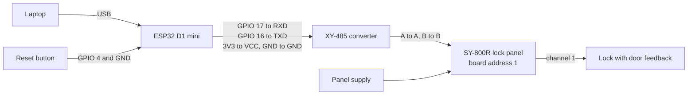

When you finish this page, the ESP32 reaches the lock panel over RS485 and the reset
button is connected. The pins are the build defaults. There are no photos of the bench
yet, so compare terminal names with the documentation of your own boards.

## Wiring diagram

## ESP32 to RS485 converter

| ESP32 | XY-485 |
| --- | --- |
| GPIO 17 (UART 2 TX) | RXD |
| GPIO 16 (UART 2 RX) | TXD |
| 3V3 | VCC |
| GND | GND |

UART 0 carries the USB console and cannot be used for the bus. To use other pins, change
them with `idf.py menuconfig`, under **Locker RS485 serial line**.

## Converter to lock panel

1. Connect A of the converter to A of the panel, and B to B.
2. Set the panel's DIP switches to board address 1. How the switches map to an address is
   in the seller's documentation for the panel.

The firmware talks at 9600 baud, 8N1 by default. The bench panel answers at those settings,
in about 265 ms against a 1500 ms reply deadline. The
[Reference](/dokumentation/esp32/reference/#serial-line-and-timing) lists every setting.

## Reset button

Connect a push button from GPIO 4 to GND. The firmware uses the internal pull-up, so you
need no resistor. To use another pin, change **Locker reset button** in `idf.py menuconfig`.
The build refuses strapping, flash, input-only, console and RS485 pins.

## Power

- **Panel and locks:** the panel has its own supply. Its voltage is not established in this
  project, so take it from the seller's documentation.
- **ESP32 and converter:** on the bench, the USB cable powers the ESP32, and the ESP32's 3V3
  powers the converter. A permanent supply for the ESP32 has not been designed.
- **Flyback diodes:** the [hardware list](/dokumentation/hardware/#common-components)
  recommends a 1N4007 across each 12 V lock on the Raspberry Pi build. Whether this panel
  needs them has not been tested.

## Before you power on

- [ ] The panel supply voltage is right for the panel and the locks. Measure it.
- [ ] A goes to A and B to B.
- [ ] RXD and TXD are not swapped. GPIO 17 goes to RXD.
- [ ] The converter's VCC goes to 3V3 and its GND to the ESP32's GND.
- [ ] The panel is set to board address 1.
- [ ] Nothing behind the door of channel 1 can be damaged if the lock releases.

Keep the panel supply off until the [bench test](/dokumentation/esp32/bench-test/). The
firmware is designed to send nothing to the panel while it boots, but the hardware check
for that has no signed-off result.

## If the bus stays silent

See [Troubleshooting](/dokumentation/esp32/troubleshooting/#symptom-cause-fix). A converter
wired so that it only echoes requests makes all doors read as open, and unlocks never get
an acknowledgement.

## Next

[Flash the firmware](/dokumentation/esp32/flashing/).
